# Membership, heartbeat e gossip

*Programação Distribuída · Checkpoint 3 · Aluno 1*

**Como os Super Peers descobrem quem está vivo**

| | |
|---|---|
| Branch | `unificacao-checkpoint-3` |
| Commit | `6841a9b Checkpoint 3 -- Bibliotecas` |
| Comparado com | `origin/Aluno1 (183c1b1)` |
| Teste C3 | PASS 5, FAIL 0 (rodado para este documento) |

Cores dos diagramas: cinza = seção comum / base, verde = Aluno 1 (gossip), azul = Aluno 2 (Chord).

## Sumário

1. Parte 1. Seção comum: sistema, arquivos e compilação, threads, ordem do main, protocolo, como as partes se encaixam, teste do C3
2. Parte 2. Aluno 1: ideia, estruturas, máquina de estados, execução de uma rodada, formato das mensagens, todas as funções do gossip.c, provedores e comandos do peer.c, o que mudou em relação à branch Aluno1, observações, log esperado

---

# Parte 1. Seção comum

*O que os dois alunos precisam saber do código inteiro do Checkpoint 3. Esta parte é idêntica nos dois documentos.*

## 1.1 O sistema no Checkpoint 3

Nos Checkpoints 1 e 2 um **Peer** entrava num **Super Peer** (JOIN), registrava arquivos (STORE) e buscava pelo nome (LOOKUP). No Checkpoint 3 os **Super Peers passam a conversar entre si** de duas formas independentes:

- **[Aluno 2]** **Anel Chord** (`chord.c`): os Super Peers ficam ordenados pelo NodeID num anel de 2<sup>256</sup> posições. Cada um conhece o seu *successor*, o seu *predecessor* e uma *finger table* de atalhos, e sabe descobrir qual nó é dono de um ID qualquer.
- **[Aluno 1]** **Membership com heartbeat e gossip** (`gossip.c`): cada Super Peer mantém a lista de todos os outros, manda heartbeat a cada 5 s, troca a lista com um vizinho sorteado e marca quem parou de responder como SUSPECT, FAILED e REMOVED.

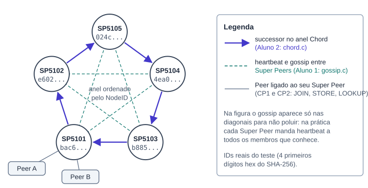

**Figura 1.** Os 5 Super Peers do teste, na ordem real do anel (pelo NodeID). As setas são o successor de cada nó.

Os nomes `SP5101` a `SP5105` vêm da porta (sem `--name`, o nome vira `SP<porta>`). A ordem do anel não é a ordem das portas: é a ordem do NodeID, que é o SHA-256 de IP, porta e UUID. No teste real o anel ficou `SP5105 → SP5104 → SP5103 → SP5101 → SP5102 → SP5105`.

## 1.2 Arquivos, responsáveis e compilação

| Arquivo | Responsável | O que faz no CP3 |
|---|---|---|
| `superpeer.c` | os dois | `main`, leitura das opções, tabela de peers, despacho das mensagens. Recebe os handlers do Chord (Aluno 2) e do gossip (Aluno 1). |
| `chord.c` | **[Aluno 2]** | Anel Chord inteiro: estado, aritmética, lookup iterativo, join, stabilize, notify, fix_fingers, handlers 21 a 25. |
| `gossip.c` | **[Aluno 1]** | Membership dos Super Peers: heartbeat, gossip push-pull, estados ALIVE, SUSPECT, FAILED, REMOVED. |
| `peer.c` | **[Aluno 1]** | Cliente. Ganhou `--cmd topology` e `--cmd lookup --object-id`, e passou a ler a lista de provedores do LOOKUP. |
| `protocol.c`, `network.c` | **[Aluno 1]** | Header, CRC32, empacotamento, sockets. No CP3 só ganharam os códigos e nomes novos. |
| `metadata.c` | base CP2 | Hash table de metadados. Ganhou a lista de provedores (Aluno 1) e o `metadata_print` após inserir (Aluno 2). |
| `node.c` | base CP1 | UUID, NodeID, parse de IP e porta. Só mudou para a compilação separada. |

### Compilação separada (commit "Bibliotecas")

Até o CP3 de cada aluno, cada binário era **uma única unidade de compilação**: o `superpeer.c` fazia `#include "node.c"`, `#include "chord.c"` etc. Na unificação isso virou o padrão normal de C: cada `.c` tem o seu cabeçalho em `include/*.h`, é compilado sozinho para `build/*.o`, e o linker junta os objetos.

```diff
@@ superpeer.c (antes, nas branches dos alunos) @@
-#include "node.c"
-#include "network.c"
-#include "metadata.c"
-#include "chord.c"
@@ superpeer.c (unificado) @@
+#include "include/node.h"
+#include "include/network.h"
+#include "include/metadata.h"
+#include "include/chord.h"
+#include "include/gossip.h"
```

```makefile
# Makefile unificado: um .o por .c e link no final
SUPERPEER_OBJS = build/superpeer.o build/node.o build/protocol.o build/network.o \
                 build/metadata.o build/chord.o build/gossip.o
PEER_OBJS = build/peer.o build/node.o build/protocol.o build/network.o build/metadata.o
build/%.o: %.c | build
	$(CC) $(CFLAGS) -c -o $@ $<
```

Consequências que aparecem no código:

- Tipos usados por mais de um arquivo foram para os headers: `ChordNode`, `CHORD_NODE_MAX`, `CHORD_NAME_LEN`, `CHORD_TEXT_LEN` em `chord.h`; `Header`, `Mensagem`, o enum de tipos, `ProviderInfo` e `VERSAO_PROTOCOLO` em `protocol.h`; `FileMetadata` e `MAX_PROVIDERS` em `metadata.h`; `Node` e `NodeConfig` em `node.h`.
- Funções chamadas de outro arquivo deixaram de ser `static`: `chord_same`, `chord_node_write`, `chord_node_read`, `chord_has_bytes` (o gossip usa) e `node_parse_ip`, `node_parse_port` (chord.c e superpeer.c usam).
- Cada `.c` passou a ter o seu `#define _POSIX_C_SOURCE 200809L`.
- `-llz4` já estava no Makefile desde o CP2 (compressão dos chunks no `peer.c`); continua lá.

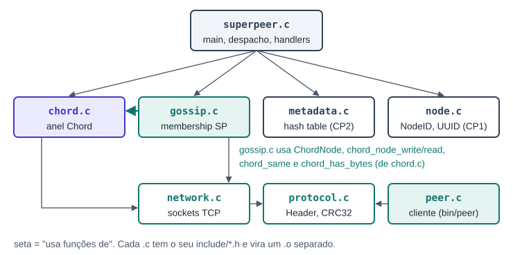

**Figura 2.** Quem usa quem. O gossip reaproveita a representação de nó e a serialização do Chord.

## 1.3 Threads e mutexes do Super Peer

Um Super Peer em execução tem quatro tipos de thread. Todas compartilham quatro tabelas, cada uma protegida pelo seu mutex:

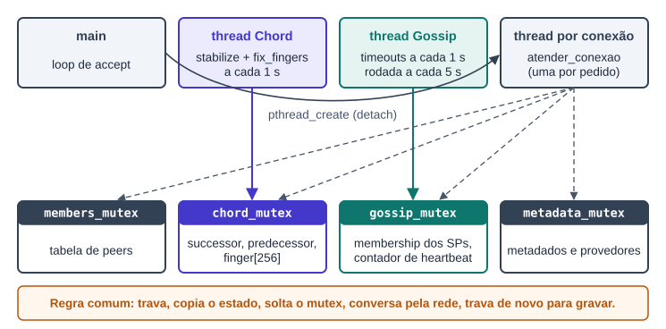

**Figura 3.** Threads (em cima) e o estado que cada uma toca (embaixo). Linhas tracejadas: a thread de conexão acessa o estado através dos handlers.

- **main**: só aceita conexões e cria uma thread por conexão.
- **thread do Chord** **[Aluno 2]**: faz o join (se houver bootstrap) e depois repete stabilize e fix_fingers a cada 1 s.
- **thread do Gossip** **[Aluno 1]**: a cada 1 s confere os prazos; a cada 5 s faz uma rodada (heartbeat a todos e gossip com um sorteado).
- **thread por conexão**: recebe uma mensagem, chama o handler certo, responde e fecha o socket.

> **A regra que os dois seguem**
>
> Nenhum mutex fica travado durante uma chamada de rede. O padrão é sempre: **trava, copia o que precisa, solta, conversa com o outro nó, trava de novo para gravar o resultado**. Assim, um nó lento ou morto nunca prende as outras threads, e não existe deadlock entre os mutexes (nenhuma função segura dois deles ao mesmo tempo).

## 1.4 A ordem de execução do `main`

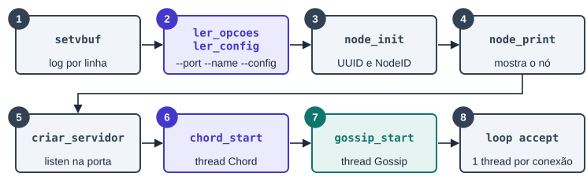

**Figura 4.** Ordem do `main` em `superpeer.c:716`. Azul: parte do Aluno 2. Verde: parte do Aluno 1.

1. `setvbuf(stdout, NULL, _IOLBF, 0)`: cada linha do log sai na hora, mesmo redirecionada para arquivo (o teste lê o log).
2. Se o primeiro argumento não começa com `-`, usa o formato posicional do CP1 (`node_parse_args`). Senão chama `ler_opcoes`, que lê `--port`, `--name`, `--config` e o arquivo de configuração (chave `bootstrap=ip:porta`). Nome padrão `SP<porta>`; arquivo de UUID `superpeer_<porta>.uuid`.
3. `node_init`: carrega ou cria o UUID e calcula o NodeID = SHA-256(IP, porta, UUID).
4. `node_print`: mostra papel, IP, porta, estado e NodeID.
5. `criar_servidor`: abre a porta em modo listen. O estado vira CONNECTED e o log mostra `Node SP5101 started`.
6. `chord_start`: monta o anel de um nó só e cria a thread do Chord.
7. `gossip_start`: prepara a membership e cria a thread do Gossip.
8. Laço infinito: `aceitar_cliente`, aloca uma `Conexao` e cria a thread `atender_conexao` (com `pthread_detach`).

O socket já escuta antes das threads começarem, mas só é atendido no passo 8. Por isso nenhum handler vê o estado do Chord ou do gossip antes de ele estar iniciado.

## 1.5 Protocolo: o que toda mensagem tem


**Figura 5.** Cabeçalho fixo de toda mensagem (`include/protocol.h`).

Os pedidos entre Super Peers (Chord e gossip) sempre seguem o mesmo ciclo: **abre conexão, envia, espera a resposta, fecha**. A resposta de sucesso é `ACK` e a de erro é `ERROR`. O `no_destino` vai zerado quando o destino ainda é desconhecido (o bootstrap, que só se conhece por IP e porta).

| Código | Mensagem | Quem usa | Desde |
|---|---|---|---|
| 1 a 4 | JOIN, LEAVE, LOOKUP, STORE | Peer → Super Peer | CP1, CP2 |
| 10 | HEARTBEAT | Super Peer → Super Peer | **[CP3 Aluno 1]** |
| 11 | GOSSIP | Super Peer → Super Peer | **[CP3 Aluno 1]** |
| 17, 18 | ACK, ERROR | respostas | CP1 |
| 19, 20 | PING, PONG | teste de vida | CP1 |
| 21 | FIND_SUCCESSOR | Super Peer → Super Peer | **[CP3 Aluno 2]** |
| 22 | GET_PREDECESSOR | Super Peer → Super Peer | **[CP3 Aluno 2]** |
| 23 | NOTIFY | Super Peer → Super Peer | **[CP3 Aluno 2]** |
| 24 | CHORD_LOOKUP | Peer → Super Peer (`--cmd lookup`) | **[CP3 Aluno 2]** |
| 25 | TOPOLOGY | Peer → Super Peer (`--cmd topology`) | **[CP3 Aluno 2]** |

Os códigos 10 e 11 já existiam no enum desde o CP1, sem uso. Os códigos 21 a 25 foram acrescentados depois do `MSG_PONG = 20`.

### O nó serializado (usado pelos dois alunos)

Sempre que uma mensagem precisa carregar "um Super Peer", ela usa o mesmo formato, escrito por `chord_node_write` e lido (com validação) por `chord_node_read`, ambos em `chord.c`. O gossip reaproveita esse formato no HEARTBEAT e em cada entrada do GOSSIP.

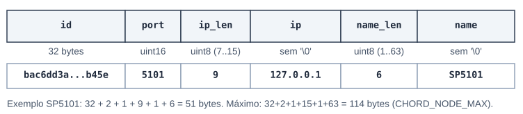

**Figura 6.** Formato de um nó na rede, sem padding e sem `'\0'`.

`chord_node_read` recusa o nó se: faltarem bytes (`chord_has_bytes`), `ip_len` estiver fora de 7..15, o IP não for válido (`node_parse_ip`), a porta for 0, `name_len` estiver fora de 1..63 ou o nome tiver um `'\0'` no meio. Qualquer falha vira resposta `ERROR`.

### Despacho em `atender_conexao`

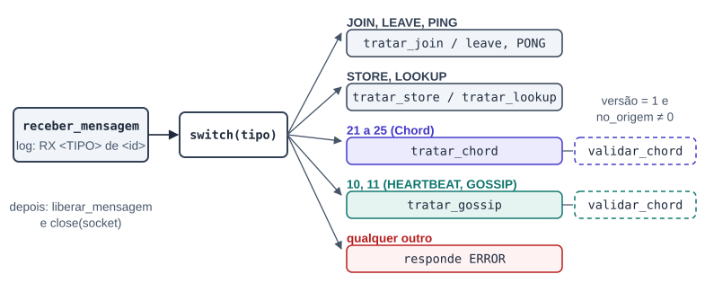

**Figura 7.** Cada conexão recebe uma mensagem e o `switch` escolhe o handler.

`validar_chord` (`superpeer.c:444`) é a validação comum das mensagens entre Super Peers: versão do protocolo igual a 1 e `no_origem` diferente de zero. Diferente da `validar_origem` do CP2, ela **não** exige que o remetente esteja na tabela de peers, porque Super Peers não fazem JOIN uns nos outros. O nome ficou "chord" porque nasceu no Chord; o gossip passou a usar a mesma função.

## 1.6 Como as duas partes se encaixam

> **Chord (Aluno 2)**
>
> Responde "*quem é o dono deste ID?*". Mantém a estrutura do anel. Quando um nó não responde, imprime `Chord: X nao respondeu` e mantém o estado: não substitui o successor.

> **Gossip (Aluno 1)**
>
> Responde "*quem está vivo?*". Mantém a lista de membros. Quando um nó para de mandar heartbeat, marca SUSPECT, FAILED e REMOVED com o tempo.

- Os dois são **independentes em tempo de execução**: cada um tem a sua thread, o seu estado e o seu mutex. O gossip não chama stabilize, e o Chord não consulta a membership.
- O ponto de contato é o **código**: o gossip usa o tipo `ChordNode` e as funções de serialização do Chord, e os dois usam `validar_chord` no `superpeer.c`.
- Os dois partem do mesmo `bootstrap` do arquivo de configuração e tratam igual o caso "bootstrap sou eu" (mesmo IP e porta): sem contato inicial.
- Os dois iniciam no `main` com a mesma assinatura: `xxx_start(&superpeer, nome, config.superpeer_ip, config.superpeer_port)`.

## 1.7 O teste do Checkpoint 3 (`tests/c3/run.sh`)

O teste sobe os 5 Super Peers **ao mesmo tempo**, todos com `--config tests/config/c3.conf --port 510X`. O arquivo de configuração tem uma linha só: `bootstrap=127.0.0.1:5101`.

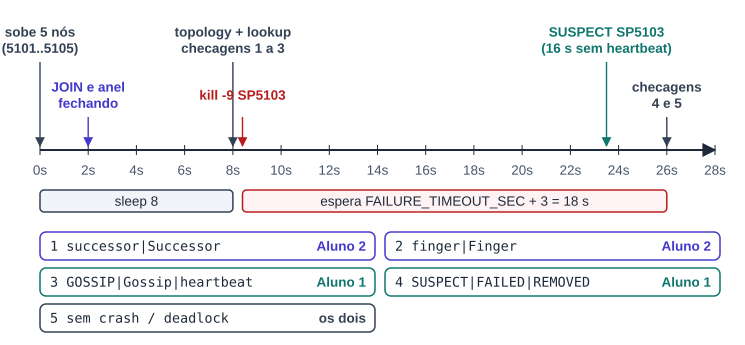

**Figura 8.** Linha do tempo do teste e qual aluno cobre cada checagem. Tempos do SUSPECT medidos no log real.

Resultado na branch `unificacao-checkpoint-3` (rodado para este documento): **PASS 5, FAIL 0**.

```text
==== C3 — Chord + Gossip ====
[PASS] Há successor no overlay
[PASS] Há finger table
[PASS] Há Gossip/heartbeat
[PASS] Há evidência de detecção de falha após timeout
[PASS] Sem crash/deadlock reportado em c3.log
PASS: 5
FAIL: 0
```

Trechos do log real do teste:

```text
Node SP5101 started
Escutando na porta 5101
Chord: anel criado por SP5101
Successor: SP5101 (127.0.0.1:5101)
Gossip: heartbeat a cada 5 s, timeout de 15 s
...
JOIN SP5104
Successor: SP5101 (127.0.0.1:5101)
Gossip: membro SP5101 (127.0.0.1:5101) ALIVE
Gossip: membro SP5103 (127.0.0.1:5103) ALIVE
```

```text
Lookup path:
SP5101
 ↓
SP5104
 ↓
SP5103
Owner: SP5103
Chord: SP5103 nao respondeu
Gossip: SP5103 nao respondeu
SUSPECT SP5103 (127.0.0.1:5103): sem heartbeat ha 16 s
```

---

# Parte 2. Aluno 1: Membership, heartbeat e gossip

*Arquivo principal `gossip.c` (444 linhas, novo). Também: `tratar_gossip` e provedores em `superpeer.c`, provedores em `metadata.c`, comandos novos em `peer.c`.*

## 2.1 A ideia em uma página

A Seção 16.8 pede que cada Super Peer saiba quais outros Super Peers estão vivos, usando **heartbeat a cada 5 s** e **timeout de 15 s**, com os estados **ALIVE → SUSPECT → FAILED → REMOVED**. O `gossip.c` resolve isso com três mecanismos:

1. **Heartbeat direto.** A cada 5 s o nó incrementa um contador próprio (`gossip_heartbeat`) e manda `HEARTBEAT(nó, contador)` para todo membro ALIVE ou SUSPECT. Quem recebe renova o prazo daquele membro.
2. **Gossip push-pull.** Na mesma rodada, o nó sorteia um membro e manda a sua tabela inteira (`GOSSIP`). O outro mescla e responde com a tabela dele, que o primeiro também mescla. Assim um nó aprende sobre membros que nunca falaram direto com ele.
3. **Relógio de prazos.** A cada 1 s, quem está sem sinal há mais de 15 s vira SUSPECT; mais de 30 s, FAILED; mais de 45 s, REMOVED.

O **contador de heartbeat funciona como versão**: uma informação só substitui a guardada se tiver contador maior (para voltar a ALIVE) ou igual/maior com estado pior (para espalhar uma suspeita). Isso impede que notícias velhas desfaçam notícias novas.

### Comparação com a tabela da Seção 7.3

| Campo pedido | Onde está em `GossipMember` |
|---|---|
| NodeID, IP, Porta | `node.id`, `node.ip`, `node.port` (um `ChordNode`, que também traz o nome) |
| Estado | `state` (0 ALIVE, 1 SUSPECT, 2 FAILED, 3 REMOVED) |
| LastHeartbeat | `last_seen` (hora local em que chegou a última prova de vida) |
| Version | `heartbeat` (contador enviado pelo próprio membro) |

## 2.2 Estruturas e constantes (`gossip.c:16-50`)

```c
#define GOSSIP_MAX 64              /* membros guardados */
#define GOSSIP_HEARTBEAT_SEC 5     /* rodada */
#define GOSSIP_TIMEOUT_SEC 15      /* 15 s SUSPECT, 30 s FAILED, 45 s REMOVED */
#define GOSSIP_ENTRY_MAX (CHORD_NODE_MAX + 1 + sizeof(uint64_t))   /* 123 bytes */

typedef enum {
    GOSSIP_ALIVE = 0, GOSSIP_SUSPECT = 1, GOSSIP_FAILED = 2, GOSSIP_REMOVED = 3
} GossipState;
typedef struct {
    ChordNode node;        /* id, ip, porta, nome */
    uint8_t   state;
    uint64_t  heartbeat;   /* contador recebido do membro */
    time_t    last_seen;   /* hora local da última prova de vida */
} GossipMember;
typedef struct { int has_bootstrap; ChordNode bootstrap; } GossipStart;

static ChordNode gossip_self;                 /* este nó */
static uint64_t gossip_heartbeat = 0;         /* contador próprio */
static GossipMember gossip_members[GOSSIP_MAX];
static int gossip_count = 0;
static pthread_mutex_t gossip_mutex = PTHREAD_MUTEX_INITIALIZER;
```

Um único mutex (`gossip_mutex`) protege o contador, o vetor e o total. Os estados seguem uma ordem numérica de "gravidade", e é isso que permite comparar `state > membro->state` para saber se uma notícia é pior.

## 2.3 Máquina de estados

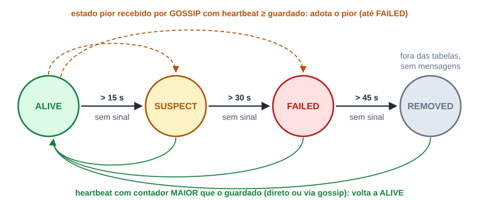

**Figura 9.** Transições da membership. Embaixo: volta para ALIVE. Em cima: suspeita espalhada por gossip.

| Transição | Quando | Quem faz | Log |
|---|---|---|---|
| ALIVE → SUSPECT | sem sinal > 15 s | `gossip_check_timeouts` | `SUSPECT SP5103 (127.0.0.1:5103): sem heartbeat ha 16 s` |
| SUSPECT → FAILED | sem sinal > 30 s | `gossip_check_timeouts` | `FAILED SP5103 (...): sem heartbeat ha 31 s` |
| FAILED → REMOVED | sem sinal > 45 s | `gossip_check_timeouts` | `REMOVED SP5103 (...): retirado da membership` |
| qualquer → ALIVE | chega ALIVE com contador maior | `gossip_apply` | `Gossip: X voltou (SUSPECT -> ALIVE)` |
| adota estado pior | GOSSIP traz estado pior com contador ≥ guardado | `gossip_apply` | `Gossip: X SUSPECT por SP5101` |

Como a checagem é a cada 1 s e usa `>`, no log a transição aparece em 16, 31 e 46 s. O que cada estado muda na prática:

- **SUSPECT**: continua recebendo heartbeat e pode ser sorteado para o gossip (pode estar só lento).
- **FAILED**: não recebe mais heartbeat, mas ainda é enviado nas tabelas (para os outros saberem).
- **REMOVED**: sai das tabelas enviadas e não recebe nada. REMOVED vindo de fora nunca é aceito: cada nó decide sozinho a remoção.

## 2.4 Execução: uma rodada de gossip

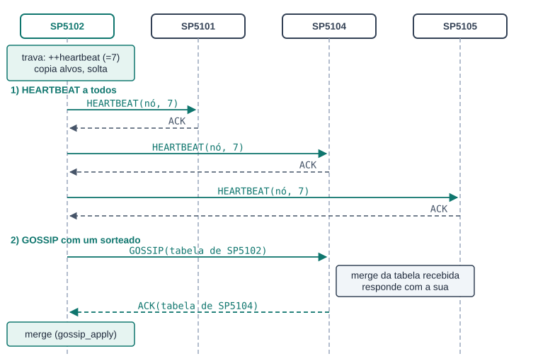

**Figura 10.** Rodada de `SP5102`: heartbeat a todos os membros e troca da tabela com um sorteado (aqui `SP5104`).

Na partida, ninguém conhece ninguém. O bootstrap do arquivo de configuração resolve isso:

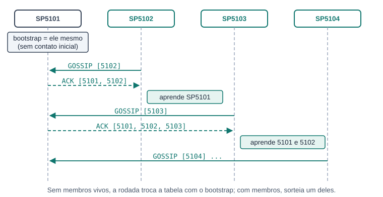

**Figura 11.** Descoberta inicial: cada nó novo troca a tabela com `SP5101`, que devolve tudo o que já conhece.

Depois da primeira troca, cada nó já tem membros vivos e passa a mandar heartbeat para eles e a sortear um deles para o gossip. Em uma ou duas rodadas (5 a 10 s) todos conhecem todos: no log real aparece `Gossip: heartbeat 2 enviado a 4 membros` já na segunda rodada.

## 2.5 Formato das mensagens HEARTBEAT e GOSSIP

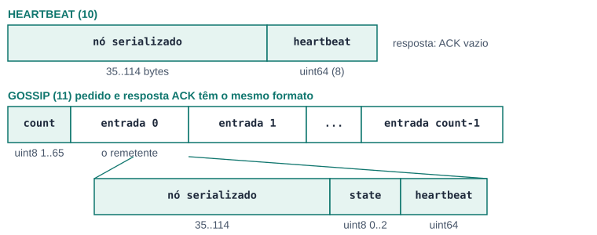

**Figura 12.** Payloads. O nó serializado é o mesmo da Figura 6 (formato do Chord).

- A **entrada 0** de toda tabela é sempre o remetente, como ALIVE e com o contador atual. É por ela que o receptor sabe "quem mandou" (o nome aparece em `Gossip: X SUSPECT por <remetente>`) e já recebe uma prova de vida dele.
- `count` vai de 1 a 65 (ele mesmo e até 64 membros). Membros REMOVED não entram.
- Ao receber, a tabela é **validada inteira antes** de mexer em qualquer coisa: se uma entrada falhar, ou se sobrar byte no fim, a tabela toda é recusada.

## 2.6 Função por função: `gossip.c`

*Legenda das fichas: **Thread** = quem executa; **Mutex** = se trava `gossip_mutex`; **Rede** = mensagens trocadas; **Log** = o que imprime.*

### Início

#### `gossip_start` · `gossip.c:378`

**Thread:** main · **Mutex:** não (ainda não há outra thread) · **Rede:** não · **Log:** Gossip: heartbeat a cada 5 s, timeout de 15 s

Chamada pelo `main` logo depois de `chord_start`. Prepara a identidade e cria a thread periódica.

1. Preenche `gossip_self` com NodeID, IP e porta do `Node` e com o nome (`SP5101`).
2. Aloca um `GossipStart`. Se a porta do bootstrap não é 0 e o bootstrap **não** é este próprio nó, guarda o bootstrap com nome `"ip:porta"` e id zerado (ainda não se sabe o NodeID dele).
3. Imprime a configuração e cria a thread `gossip_loop` com `pthread_detach`. Se o `pthread_create` falhar, libera o `GossipStart` e devolve -1 (o `main` encerra).

#### `gossip_loop` · `gossip.c:359`

**Thread:** thread Gossip · **Mutex:** indireto · **Rede:** indireto · **Log:** não

Corpo da thread. Copia o `GossipStart` para a pilha e libera o original. Gera a semente do sorteio (`time(NULL) ^ porta`, para que cada nó sorteie diferente).

```c
for (;;) {
    /* rodada nos segundos 0, 5, 10 ... */
    if (segundos % GOSSIP_HEARTBEAT_SEC == 0)
        gossip_round(&inicio, &semente);
    /* prazos todo segundo */
    gossip_check_timeouts();
    sleep(1);
    segundos++;
}
```

> A primeira rodada é imediata (segundos = 0): é ela que dispara a descoberta pelo bootstrap.

### Rodada periódica

#### `gossip_round` · `gossip.c:319`

**Thread:** thread Gossip · **Mutex:** sim, só para copiar · **Rede:** HEARTBEAT × N, GOSSIP × 1 · **Log:** Gossip: heartbeat N enviado a K membros

1. Trava e faz `heartbeat = ++gossip_heartbeat`.
2. Copia para o vetor local `alvos[]` todos os membros ALIVE ou SUSPECT, e conta quantos são ALIVE (`vivos`). Solta o mutex.
3. Imprime o total e chama `gossip_send_heartbeat` para cada alvo (sem mutex).
4. Se há algum vivo, sorteia um índice com `rand_r` e chama `gossip_exchange` nele. Se não há nenhum vivo e existe bootstrap, troca com o bootstrap.

> O sorteio usa `rand_r` (reentrante) com a semente da própria thread, para não disputar o estado global do `rand`.

#### `gossip_send_heartbeat` · `gossip.c:286`

**Thread:** thread Gossip · **Mutex:** não · **Rede:** HEARTBEAT → ACK · **Log:** não

Monta no buffer da pilha `chord_node_write(&gossip_self)` + o contador (8 bytes) e manda com `gossip_request(MSG_HEARTBEAT)`. Se deu certo, só libera a resposta (o ACK vem vazio).

#### `gossip_exchange` · `gossip.c:300`

**Thread:** thread Gossip · **Mutex:** indireto · **Rede:** GOSSIP → ACK(tabela) · **Log:** Gossip: resposta invalida de X

Push-pull com um nó: `gossip_table_write` monta a tabela local, `gossip_request(MSG_GOSSIP)` envia, e a tabela que veio no ACK passa por `gossip_table_merge`. Se a resposta não validar, imprime a linha de erro. Libera a tabela e a resposta em todos os caminhos.

#### `gossip_request` · `gossip.c:243`

**Thread:** thread Gossip · **Mutex:** não · **Rede:** uma conexão por pedido · **Log:** Gossip: X nao respondeu / X recusou TIPO

O "RPC" do gossip, igual em estrutura ao `chord_request`.

1. `conectar_no_servidor(ip, porta)`. Falhou: imprime `nao respondeu` e devolve -1.
2. Monta o Header: versão 1, tipo, `no_origem = gossip_self.id`, `no_destino = destino->id`, timestamp, tamanho.
3. `enviar_mensagem`, depois `receber_mensagem`, depois `close` (sempre).
4. Erro de envio ou recepção: `nao respondeu`. Resposta que não é ACK: `recusou`. Nos dois casos libera a resposta.

> É este "nao respondeu" que aparece no log logo depois do `kill -9`: o heartbeat para SP5103 falha na hora (conexão recusada), mas o estado só muda quando o prazo vence.

### Tabela: escrever e ler

#### `gossip_table_write` · `gossip.c:163`

**Thread:** thread Gossip e thread de conexão · **Mutex:** sim · **Rede:** não · **Log:** não

1. Trava e aloca `1 + 65 × 123` bytes (o pior caso).
2. Escreve a entrada 0: o próprio nó, ALIVE, com `gossip_heartbeat`.
3. Escreve cada membro que não está REMOVED (nó, estado, contador).
4. Solta, grava `saida[0] = total` e devolve o buffer. Quem chamou faz o `free`.

#### `gossip_entry_write` · `gossip.c:152`

**Thread:** quem chamar · **Mutex:** não · **Rede:** não · **Log:** não

Escreve uma entrada: `chord_node_write`, depois 1 byte de estado, depois 8 bytes do contador (`memcpy`, ordem da máquina). Devolve quantos bytes usou.

#### `gossip_table_merge` · `gossip.c:211`

**Thread:** thread Gossip e thread de conexão · **Mutex:** sim, só na fase de aplicar · **Rede:** não · **Log:** indireto (gossip_apply)

1. Confere `buffer[0]` entre 1 e 65.
2. **Sem mutex**, lê todas as entradas para um vetor local com `gossip_entry_read`. Qualquer erro, ou `pos != tamanho` no fim: devolve -1 sem ter mudado nada.
3. Só então trava e chama `gossip_apply` para cada entrada, passando como origem o nome da entrada 0 (o remetente).

> Validar tudo antes de aplicar evita deixar a membership "pela metade" com um pacote corrompido, e parsear fora do mutex deixa o tempo de trava mínimo.

#### `gossip_entry_read` · `gossip.c:196`

**Thread:** quem chamar · **Mutex:** não · **Rede:** não · **Log:** não

Zera a entrada, lê o nó com `chord_node_read` (todas as validações da Seção 1.5), confere com `chord_has_bytes` que ainda há 9 bytes, lê estado e contador. Recusa estado maior que FAILED (ninguém aceita REMOVED de fora).

### Regras

#### `gossip_apply` · `gossip.c:74`

**Thread:** quem chamar, com o mutex já travado · **Mutex:** já travado · **Rede:** não · **Log:** Gossip: membro / voltou / SUSPECT por

O coração da membership: decide o que fazer com uma notícia sobre um nó (vinda de HEARTBEAT ou de uma entrada de GOSSIP). As quatro perguntas da Figura 13 são feitas nesta ordem.

> A regra 3 usa `>` (contador estritamente maior) e a regra 4 usa `>=`: para voltar a ALIVE é preciso uma prova de vida nova; para espalhar uma suspeita basta não ser mais velha. A regra 4 não mexe em `last_seen`, então o prazo local continua contando.

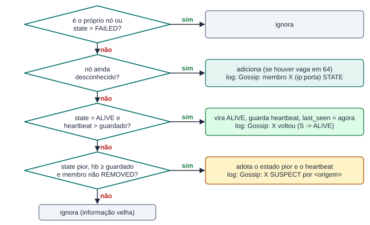

**Figura 13.** Decisão de `gossip_apply`, na ordem do código.

#### `gossip_check_timeouts` · `gossip.c:121`

**Thread:** thread Gossip (todo segundo) · **Mutex:** sim · **Rede:** não · **Log:** SUSPECT / FAILED / REMOVED

Trava, calcula `sem_sinal = agora - last_seen` para cada membro e avança no máximo **um passo** por chamada: ALIVE com > 15 s vira SUSPECT; SUSPECT com > 30 s vira FAILED; FAILED com > 45 s vira REMOVED. Imprime a linha correspondente. Solta.

> São essas linhas que o teste procura com `SUSPECT|FAILED|REMOVED`. O Chord nunca imprime essas palavras.

#### `gossip_find` · `gossip.c:61`

**Thread:** quem chamar, com o mutex travado · **Mutex:** já travado · **Rede:** não · **Log:** não

Busca linear do NodeID em `gossip_members[0..gossip_count)` com `node_id_compare`. Devolve o índice ou -1.

#### `gossip_state_name` · `gossip.c:53`

**Thread:** qualquer · **Mutex:** não · **Rede:** não · **Log:** não

Converte 0..3 em `"ALIVE"`, `"SUSPECT"`, `"FAILED"`, `"REMOVED"` para o log; fora disso `"UNKNOWN"`.

### Recepção (chamadas pelo `superpeer.c`)

#### `gossip_handle_heartbeat` · `gossip.c:417`

**Thread:** thread de conexão · **Mutex:** sim · **Rede:** recebe HEARTBEAT · **Log:** indireto

Lê o nó com `chord_node_read` e exige que sobrem **exatamente** 8 bytes. Lê o contador, trava e chama `gossip_apply(nó, ALIVE, contador, nome)`. Solta. Não usa a rede: a resposta ACK é enviada pelo `tratar_gossip`.

#### `gossip_handle_gossip` · `gossip.c:437`

**Thread:** thread de conexão · **Mutex:** indireto · **Rede:** recebe GOSSIP, devolve tabela · **Log:** indireto

`gossip_table_merge` com o que chegou; se validou, `gossip_table_write` monta a resposta (a tabela local já atualizada). O `tratar_gossip` envia e faz o `free`.

## 2.7 Código do Aluno 1 fora do `gossip.c`

### superpeer.c

#### `tratar_gossip` · `superpeer.c:508`

**Thread:** thread de conexão · **Mutex:** não · **Rede:** responde ACK ou ERROR · **Log:** X recusado: payload invalido

1. `validar_chord` (versão 1, origem não zerada). Falhou: `ERROR`.
2. HEARTBEAT → `gossip_handle_heartbeat`. GOSSIP → `gossip_handle_gossip`, que preenche `tabela`.
3. Erro: imprime e responde `ERROR`. Sucesso: `responder_com_payload(ACK, tabela)` (vazio no HEARTBEAT) e `free(tabela)`.

No `atender_conexao` entraram os casos `MSG_HEARTBEAT` e `MSG_GOSSIP`, e no `main` a chamada `gossip_start(...)` logo depois do `chord_start`.

### Provedores no LOOKUP por nome

Na branch `Aluno1` foi acrescentada a lista de **provedores** de cada arquivo: quem fez o STORE passa a constar como provedor, e o LOOKUP devolve IP e porta dos provedores, para o peer saber de quem baixar.

#### `metadata_add_provider` · `metadata.c:583`

**Thread:** thread de conexão (STORE) · **Mutex:** metadata_mutex · **Rede:** não · **Log:** não

Acha o arquivo pelo ObjectID. Se o NodeID já está na lista, não duplica. Senão acrescenta, até `MAX_PROVIDERS` (10); lista cheia devolve `METADATA_ERR_FULL`. Chamada em `tratar_store` quando `metadata_table_insert` deu certo, com o `no_origem` do pedido.

#### `metadata_get_providers` · `metadata.c:625`

**Thread:** thread de conexão (LOOKUP) · **Mutex:** metadata_mutex · **Rede:** não · **Log:** não

Copia os NodeIDs dos provedores e o total para o chamador.

#### `member_table_get_provider_info` · `superpeer.c:142`

**Thread:** thread de conexão · **Mutex:** members_mutex · **Rede:** não · **Log:** não

Procura o NodeID na tabela de peers (os que fizeram JOIN) e copia IP e porta para um `ProviderInfo` (zerado antes com `memset`). Peer que já saiu devolve `MEMBER_ERR_NOT_FOUND` e fica fora da resposta.

#### `tratar_lookup_responder` · `superpeer.c:364`

**Thread:** thread de conexão · **Mutex:** indireto (os dois acima) · **Rede:** resposta ACK · **Log:** LOOKUP: arquivo X encontrado (N provedores)

Separada do `tratar_lookup` na unificação para deixar a função curta. Busca os provedores, converte cada um em `ProviderInfo`, monta `metadado | count | ProviderInfo × count` num buffer alocado, responde e libera. Sem memória: `ERROR`.

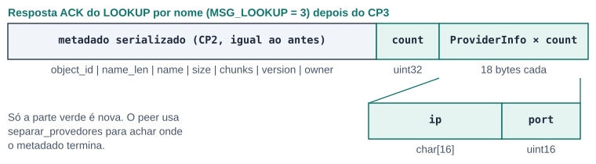

**Figura 14.** Resposta do LOOKUP por nome no CP3.

### peer.c (cliente)

#### `separar_provedores` · `peer.c:150`

**Thread:** cliente · **Mutex:** não · **Rede:** não · **Log:** Provedor: ip:porta

Percorre o cabeçalho do metadado serializado só para achar onde ele termina (pula nome, tamanho, `chunk_count × 32`, versão e dono), lê o `count`, exige que o fim calculado seja exatamente o tamanho do payload, imprime cada provedor e devolve o tamanho do metadado. Depois disso `metadata_deserialize` recebe só a parte do metadado, como no CP2.

#### `ler_object_id` · `peer.c:185`

**Thread:** cliente · **Mutex:** não · **Rede:** não · **Log:** não

Converte o argumento de `--object-id`: exige exatamente 64 caracteres hexadecimais e transforma cada par em um byte com `sscanf("%2x")`.

No `main` do `peer.c`:

- Opção nova `--object-id` (`-x`), obrigatória quando `--cmd lookup`.
- `--cmd topology` manda `MSG_TOPOLOGY` com payload vazio; `--cmd lookup` manda `MSG_CHORD_LOOKUP` com os 32 bytes do ObjectID.
- Para esses dois, a resposta ACK já é texto pronto e é impressa com `fwrite`; resposta diferente de ACK imprime `Erro: super peer respondeu X`.
- A resposta do LOOKUP por nome passa por `separar_provedores` antes de `metadata_deserialize`.

```text
bin/client --cmd topology --host 127.0.0.1 --port 5101
bin/client --cmd lookup --object-id abababab...ab --host 127.0.0.1 --port 5101
```

## 2.8 O que mudou em relação à branch `Aluno1`

Base de comparação: `origin/Aluno1`, commit `183c1b1` ("Atualizacao dos arquivos do Aluno 1"). Nessa branch existiam só os provedores; **o gossip, o `tratar_gossip` e os comandos novos do cliente entraram na unificação**.

| Arquivo |  | Mudança |
|---|---|---|
| `gossip.c` | **[novo]** | Arquivo inteiro: membership, heartbeat, gossip, estados. |
| `include/gossip.h` | **[novo]** | Declara `gossip_start`, `gossip_handle_heartbeat`, `gossip_handle_gossip`. |
| `superpeer.c` | **[alterado]** | `tratar_gossip`, casos HEARTBEAT e GOSSIP no despacho, `gossip_start` no `main`. Código de provedores reorganizado: `tratar_lookup_responder` separado, checagem de `NULL` e `memset` em `member_table_get_provider_info`, constante `MAX_PROVIDERS` no lugar do número 10. Includes de `.c` trocados por headers. |
| `peer.c` | **[alterado]** | `separar_provedores`, `ler_object_id`, `--object-id`, comandos `topology` e `lookup`, tratamento das respostas em texto. |
| `protocol.c` | **[alterado]** | Nomes `HEARTBEAT`, `GOSSIP` e os cinco do Chord em `nome_do_tipo`. Enum, `Header`, `Mensagem` e `ProviderInfo` foram para `include/protocol.h`. |
| `network.c` | **[header]** | Só troca `#include "protocol.c"` por `include/network.h` e ganha `_POSIX_C_SOURCE`. |
| `metadata.c` | **[header]** | Funções de provedores iguais; definições e protótipos foram para `include/metadata.h`. Ganhou o `metadata_print` após inserir (pendência do CP2, Aluno 2). |

```diff
@@ superpeer.c: tratar_lookup (branch Aluno1 → unificado) @@
-    uint8_t providers[10][32];
-    int p_count = 0;
-    metadata_get_providers(meta.object_id, providers, &p_count);
-    ... (montagem do payload dentro do tratar_lookup)
+    tratar_lookup_responder(conexao, msg, nome, &meta, payload, tamanho_payload);
@@ superpeer.c: atender_conexao @@
+        case MSG_HEARTBEAT:
+        case MSG_GOSSIP:
+            tratar_gossip(&conexao, &msg);
+            break;
@@ superpeer.c: main @@
+    if (gossip_start(&superpeer, nome, config.superpeer_ip, config.superpeer_port) != 0) {
+        fprintf(stderr, "Erro: nao foi possivel iniciar o Gossip\n");
```

## 2.9 Observações sobre o comportamento atual

> **Pontos que vale conhecer (não quebram o teste)**
>
> - **Vaga de REMOVED não é liberada.** O membro REMOVED continua ocupando posição em `gossip_members` e `gossip_count` nunca diminui. Com muitas entradas e saídas, as 64 vagas podem acabar.
> - **O sorteio pode cair num SUSPECT.** O comentário diz "sorteia um membro vivo", mas o índice é sorteado entre todos os alvos (ALIVE e SUSPECT). A condição `vivos > 0` só decide se sorteia ou usa o bootstrap.
> - **Reinício zera o contador.** Um Super Peer reiniciado volta a mandar heartbeat a partir de 1. Os outros guardaram um número maior, então ignoram os heartbeats dele até o contador passar o valor antigo.
> - **Sem timeout de socket.** Um nó que aceita a conexão mas não responde travaria a thread do gossip. Com `kill -9` em localhost a conexão é recusada na hora, por isso não aparece no teste.

## 2.10 Log esperado da parte do Aluno 1

```text
Gossip: heartbeat a cada 5 s, timeout de 15 s
Gossip: membro SP5101 (127.0.0.1:5101) ALIVE
Gossip: membro SP5103 (127.0.0.1:5103) ALIVE
Gossip: heartbeat 2 enviado a 4 membros
RX GOSSIP de b885dbd0...
RX HEARTBEAT de 4ea050e2...
Gossip: SP5103 nao respondeu                   (depois do kill -9)
SUSPECT SP5103 (127.0.0.1:5103): sem heartbeat ha 16 s
FAILED SP5103 (127.0.0.1:5103): sem heartbeat ha 31 s
REMOVED SP5103 (127.0.0.1:5103): retirado da membership
```

*As linhas até SUSPECT são do log real do teste. As linhas FAILED e REMOVED mostram o formato impresso pelo código: elas só aparecem se os processos continuarem rodando, porque o teste encerra cerca de 18 s depois do `kill`.*
