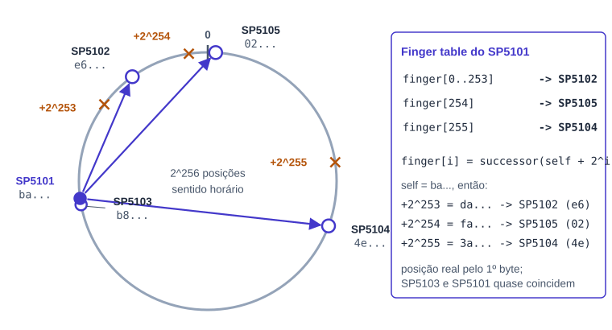
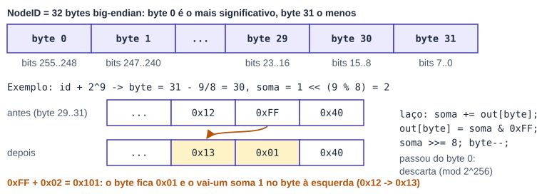
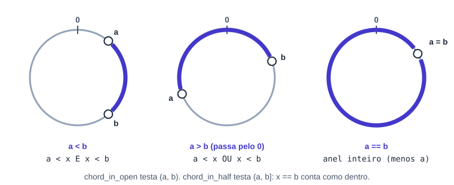
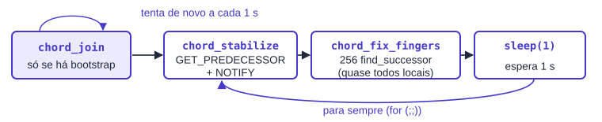
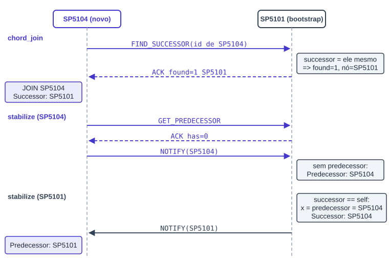
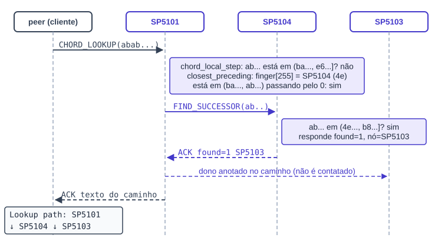
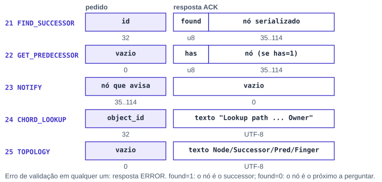

# Anel Chord entre os Super Peers

*Programação Distribuída · Checkpoint 3 · Aluno 2*

**Successor, predecessor, finger table e lookup iterativo**

| | |
|---|---|
| Branch | `unificacao-checkpoint-3` |
| Commit | `6841a9b Checkpoint 3 -- Bibliotecas` |
| Comparado com | `aluno-2-chekpoint-3 (a2416da)` |
| Teste C3 | PASS 5, FAIL 0 (rodado para este documento) |

Cores dos diagramas: cinza = seção comum / base, verde = Aluno 1 (gossip), azul = Aluno 2 (Chord).

## Sumário

1. Parte 1. Seção comum: sistema, arquivos e compilação, threads, ordem do main, protocolo, como as partes se encaixam, teste do C3
2. Parte 2. Aluno 2: ideia e decisões, estado, aritmética do anel, formação do anel, lookup iterativo, mensagens 21 a 25, todas as funções do chord.c, código no superpeer.c, o que mudou em relação à branch aluno-2-chekpoint-3, observações, log real

---

# Parte 1. Seção comum

*O que os dois alunos precisam saber do código inteiro do Checkpoint 3. Esta parte é idêntica nos dois documentos.*

## 1.1 O sistema no Checkpoint 3

Nos Checkpoints 1 e 2 um **Peer** entrava num **Super Peer** (JOIN), registrava arquivos (STORE) e buscava pelo nome (LOOKUP). No Checkpoint 3 os **Super Peers passam a conversar entre si** de duas formas independentes:

- **[Aluno 2]** **Anel Chord** (`chord.c`): os Super Peers ficam ordenados pelo NodeID num anel de 2<sup>256</sup> posições. Cada um conhece o seu *successor*, o seu *predecessor* e uma *finger table* de atalhos, e sabe descobrir qual nó é dono de um ID qualquer.
- **[Aluno 1]** **Membership com heartbeat e gossip** (`gossip.c`): cada Super Peer mantém a lista de todos os outros, manda heartbeat a cada 5 s, troca a lista com um vizinho sorteado e marca quem parou de responder como SUSPECT, FAILED e REMOVED.


**Figura 1.** Os 5 Super Peers do teste, na ordem real do anel (pelo NodeID). As setas são o successor de cada nó.

Os nomes `SP5101` a `SP5105` vêm da porta (sem `--name`, o nome vira `SP<porta>`). A ordem do anel não é a ordem das portas: é a ordem do NodeID, que é o SHA-256 de IP, porta e UUID. No teste real o anel ficou `SP5105 → SP5104 → SP5103 → SP5101 → SP5102 → SP5105`.

## 1.2 Arquivos, responsáveis e compilação

| Arquivo | Responsável | O que faz no CP3 |
|---|---|---|
| `superpeer.c` | os dois | `main`, leitura das opções, tabela de peers, despacho das mensagens. Recebe os handlers do Chord (Aluno 2) e do gossip (Aluno 1). |
| `chord.c` | **[Aluno 2]** | Anel Chord inteiro: estado, aritmética, lookup iterativo, join, stabilize, notify, fix_fingers, handlers 21 a 25. |
| `gossip.c` | **[Aluno 1]** | Membership dos Super Peers: heartbeat, gossip push-pull, estados ALIVE, SUSPECT, FAILED, REMOVED. |
| `peer.c` | **[Aluno 1]** | Cliente. Ganhou `--cmd topology` e `--cmd lookup --object-id`, e passou a ler a lista de provedores do LOOKUP. |
| `protocol.c`, `network.c` | **[Aluno 1]** | Header, CRC32, empacotamento, sockets. No CP3 só ganharam os códigos e nomes novos. |
| `metadata.c` | base CP2 | Hash table de metadados. Ganhou a lista de provedores (Aluno 1) e o `metadata_print` após inserir (Aluno 2). |
| `node.c` | base CP1 | UUID, NodeID, parse de IP e porta. Só mudou para a compilação separada. |

### Compilação separada (commit "Bibliotecas")

Até o CP3 de cada aluno, cada binário era **uma única unidade de compilação**: o `superpeer.c` fazia `#include "node.c"`, `#include "chord.c"` etc. Na unificação isso virou o padrão normal de C: cada `.c` tem o seu cabeçalho em `include/*.h`, é compilado sozinho para `build/*.o`, e o linker junta os objetos.

```diff
@@ superpeer.c (antes, nas branches dos alunos) @@
-#include "node.c"
-#include "network.c"
-#include "metadata.c"
-#include "chord.c"
@@ superpeer.c (unificado) @@
+#include "include/node.h"
+#include "include/network.h"
+#include "include/metadata.h"
+#include "include/chord.h"
+#include "include/gossip.h"
```

```makefile
# Makefile unificado: um .o por .c e link no final
SUPERPEER_OBJS = build/superpeer.o build/node.o build/protocol.o build/network.o \
                 build/metadata.o build/chord.o build/gossip.o
PEER_OBJS = build/peer.o build/node.o build/protocol.o build/network.o build/metadata.o
build/%.o: %.c | build
	$(CC) $(CFLAGS) -c -o $@ $<
```

Consequências que aparecem no código:

- Tipos usados por mais de um arquivo foram para os headers: `ChordNode`, `CHORD_NODE_MAX`, `CHORD_NAME_LEN`, `CHORD_TEXT_LEN` em `chord.h`; `Header`, `Mensagem`, o enum de tipos, `ProviderInfo` e `VERSAO_PROTOCOLO` em `protocol.h`; `FileMetadata` e `MAX_PROVIDERS` em `metadata.h`; `Node` e `NodeConfig` em `node.h`.
- Funções chamadas de outro arquivo deixaram de ser `static`: `chord_same`, `chord_node_write`, `chord_node_read`, `chord_has_bytes` (o gossip usa) e `node_parse_ip`, `node_parse_port` (chord.c e superpeer.c usam).
- Cada `.c` passou a ter o seu `#define _POSIX_C_SOURCE 200809L`.
- `-llz4` já estava no Makefile desde o CP2 (compressão dos chunks no `peer.c`); continua lá.


**Figura 2.** Quem usa quem. O gossip reaproveita a representação de nó e a serialização do Chord.

## 1.3 Threads e mutexes do Super Peer

Um Super Peer em execução tem quatro tipos de thread. Todas compartilham quatro tabelas, cada uma protegida pelo seu mutex:


**Figura 3.** Threads (em cima) e o estado que cada uma toca (embaixo). Linhas tracejadas: a thread de conexão acessa o estado através dos handlers.

- **main**: só aceita conexões e cria uma thread por conexão.
- **thread do Chord** **[Aluno 2]**: faz o join (se houver bootstrap) e depois repete stabilize e fix_fingers a cada 1 s.
- **thread do Gossip** **[Aluno 1]**: a cada 1 s confere os prazos; a cada 5 s faz uma rodada (heartbeat a todos e gossip com um sorteado).
- **thread por conexão**: recebe uma mensagem, chama o handler certo, responde e fecha o socket.

> **A regra que os dois seguem**
>
> Nenhum mutex fica travado durante uma chamada de rede. O padrão é sempre: **trava, copia o que precisa, solta, conversa com o outro nó, trava de novo para gravar o resultado**. Assim, um nó lento ou morto nunca prende as outras threads, e não existe deadlock entre os mutexes (nenhuma função segura dois deles ao mesmo tempo).

## 1.4 A ordem de execução do `main`


**Figura 4.** Ordem do `main` em `superpeer.c:716`. Azul: parte do Aluno 2. Verde: parte do Aluno 1.

1. `setvbuf(stdout, NULL, _IOLBF, 0)`: cada linha do log sai na hora, mesmo redirecionada para arquivo (o teste lê o log).
2. Se o primeiro argumento não começa com `-`, usa o formato posicional do CP1 (`node_parse_args`). Senão chama `ler_opcoes`, que lê `--port`, `--name`, `--config` e o arquivo de configuração (chave `bootstrap=ip:porta`). Nome padrão `SP<porta>`; arquivo de UUID `superpeer_<porta>.uuid`.
3. `node_init`: carrega ou cria o UUID e calcula o NodeID = SHA-256(IP, porta, UUID).
4. `node_print`: mostra papel, IP, porta, estado e NodeID.
5. `criar_servidor`: abre a porta em modo listen. O estado vira CONNECTED e o log mostra `Node SP5101 started`.
6. `chord_start`: monta o anel de um nó só e cria a thread do Chord.
7. `gossip_start`: prepara a membership e cria a thread do Gossip.
8. Laço infinito: `aceitar_cliente`, aloca uma `Conexao` e cria a thread `atender_conexao` (com `pthread_detach`).

O socket já escuta antes das threads começarem, mas só é atendido no passo 8. Por isso nenhum handler vê o estado do Chord ou do gossip antes de ele estar iniciado.

## 1.5 Protocolo: o que toda mensagem tem


**Figura 5.** Cabeçalho fixo de toda mensagem (`include/protocol.h`).

Os pedidos entre Super Peers (Chord e gossip) sempre seguem o mesmo ciclo: **abre conexão, envia, espera a resposta, fecha**. A resposta de sucesso é `ACK` e a de erro é `ERROR`. O `no_destino` vai zerado quando o destino ainda é desconhecido (o bootstrap, que só se conhece por IP e porta).

| Código | Mensagem | Quem usa | Desde |
|---|---|---|---|
| 1 a 4 | JOIN, LEAVE, LOOKUP, STORE | Peer → Super Peer | CP1, CP2 |
| 10 | HEARTBEAT | Super Peer → Super Peer | **[CP3 Aluno 1]** |
| 11 | GOSSIP | Super Peer → Super Peer | **[CP3 Aluno 1]** |
| 17, 18 | ACK, ERROR | respostas | CP1 |
| 19, 20 | PING, PONG | teste de vida | CP1 |
| 21 | FIND_SUCCESSOR | Super Peer → Super Peer | **[CP3 Aluno 2]** |
| 22 | GET_PREDECESSOR | Super Peer → Super Peer | **[CP3 Aluno 2]** |
| 23 | NOTIFY | Super Peer → Super Peer | **[CP3 Aluno 2]** |
| 24 | CHORD_LOOKUP | Peer → Super Peer (`--cmd lookup`) | **[CP3 Aluno 2]** |
| 25 | TOPOLOGY | Peer → Super Peer (`--cmd topology`) | **[CP3 Aluno 2]** |

Os códigos 10 e 11 já existiam no enum desde o CP1, sem uso. Os códigos 21 a 25 foram acrescentados depois do `MSG_PONG = 20`.

### O nó serializado (usado pelos dois alunos)

Sempre que uma mensagem precisa carregar "um Super Peer", ela usa o mesmo formato, escrito por `chord_node_write` e lido (com validação) por `chord_node_read`, ambos em `chord.c`. O gossip reaproveita esse formato no HEARTBEAT e em cada entrada do GOSSIP.


**Figura 6.** Formato de um nó na rede, sem padding e sem `'\0'`.

`chord_node_read` recusa o nó se: faltarem bytes (`chord_has_bytes`), `ip_len` estiver fora de 7..15, o IP não for válido (`node_parse_ip`), a porta for 0, `name_len` estiver fora de 1..63 ou o nome tiver um `'\0'` no meio. Qualquer falha vira resposta `ERROR`.

### Despacho em `atender_conexao`


**Figura 7.** Cada conexão recebe uma mensagem e o `switch` escolhe o handler.

`validar_chord` (`superpeer.c:444`) é a validação comum das mensagens entre Super Peers: versão do protocolo igual a 1 e `no_origem` diferente de zero. Diferente da `validar_origem` do CP2, ela **não** exige que o remetente esteja na tabela de peers, porque Super Peers não fazem JOIN uns nos outros. O nome ficou "chord" porque nasceu no Chord; o gossip passou a usar a mesma função.

## 1.6 Como as duas partes se encaixam

> **Chord (Aluno 2)**
>
> Responde "*quem é o dono deste ID?*". Mantém a estrutura do anel. Quando um nó não responde, imprime `Chord: X nao respondeu` e mantém o estado: não substitui o successor.

> **Gossip (Aluno 1)**
>
> Responde "*quem está vivo?*". Mantém a lista de membros. Quando um nó para de mandar heartbeat, marca SUSPECT, FAILED e REMOVED com o tempo.

- Os dois são **independentes em tempo de execução**: cada um tem a sua thread, o seu estado e o seu mutex. O gossip não chama stabilize, e o Chord não consulta a membership.
- O ponto de contato é o **código**: o gossip usa o tipo `ChordNode` e as funções de serialização do Chord, e os dois usam `validar_chord` no `superpeer.c`.
- Os dois partem do mesmo `bootstrap` do arquivo de configuração e tratam igual o caso "bootstrap sou eu" (mesmo IP e porta): sem contato inicial.
- Os dois iniciam no `main` com a mesma assinatura: `xxx_start(&superpeer, nome, config.superpeer_ip, config.superpeer_port)`.

## 1.7 O teste do Checkpoint 3 (`tests/c3/run.sh`)

O teste sobe os 5 Super Peers **ao mesmo tempo**, todos com `--config tests/config/c3.conf --port 510X`. O arquivo de configuração tem uma linha só: `bootstrap=127.0.0.1:5101`.


**Figura 8.** Linha do tempo do teste e qual aluno cobre cada checagem. Tempos do SUSPECT medidos no log real.

Resultado na branch `unificacao-checkpoint-3` (rodado para este documento): **PASS 5, FAIL 0**.

```text
==== C3 — Chord + Gossip ====
[PASS] Há successor no overlay
[PASS] Há finger table
[PASS] Há Gossip/heartbeat
[PASS] Há evidência de detecção de falha após timeout
[PASS] Sem crash/deadlock reportado em c3.log
PASS: 5
FAIL: 0
```

Trechos do log real do teste:

```text
Node SP5101 started
Escutando na porta 5101
Chord: anel criado por SP5101
Successor: SP5101 (127.0.0.1:5101)
Gossip: heartbeat a cada 5 s, timeout de 15 s
...
JOIN SP5104
Successor: SP5101 (127.0.0.1:5101)
Gossip: membro SP5101 (127.0.0.1:5101) ALIVE
Gossip: membro SP5103 (127.0.0.1:5103) ALIVE
```

```text
Lookup path:
SP5101
 ↓
SP5104
 ↓
SP5103
Owner: SP5103
Chord: SP5103 nao respondeu
Gossip: SP5103 nao respondeu
SUSPECT SP5103 (127.0.0.1:5103): sem heartbeat ha 16 s
```

---

# Parte 2. Aluno 2: Anel Chord entre os Super Peers

*Arquivo principal `chord.c` (692 linhas, novo) e `include/chord.h`. Também: leitura do `--config`, `tratar_chord` e `validar_chord` em `superpeer.c`, e as duas pendências do CP2.*

## 2.1 A ideia em uma página

Cada Super Peer tem um NodeID de 256 bits. Imagine todos os valores possíveis, de 0 a 2<sup>256</sup> - 1, dispostos num círculo; cada Super Peer ocupa o ponto do seu NodeID. O **dono** de um ID qualquer (de um arquivo, por exemplo) é o primeiro nó encontrado andando no sentido horário a partir daquele ID: o *successor* do ID.

- **successor**: o próximo nó no sentido horário. Basta ele para o anel funcionar.
- **predecessor**: o nó anterior. Serve para o successor confirmar quem está antes dele.
- **finger table**: 256 atalhos. `finger[i]` é o successor de `self + 2i`. Os atalhos altos pulam meio anel, um quarto do anel etc., e o lookup fica em O(log N) saltos em vez de N.



**Figura 9.** Posição real dos 5 nós do teste pelo primeiro byte do NodeID, e a finger table do `SP5101`.

Com só 5 nós, quase todas as fingers do `SP5101` caem no successor dele (`SP5102`): os alvos `self + 2i` para `i` até 253 ficam antes de `e6...`. Só os dois maiores pulos (meio anel e um quarto de anel) atravessam o zero e caem em outros nós. A impressão mostra só a primeira posição de cada nó distinto, por isso o log tem 3 linhas e não 256.

### Decisões de projeto

| Decisão | Por quê |
|---|---|
| Lookup **iterativo** | Quem pergunta conduz a busca e anota cada nó visitado: o `Lookup path` sai pronto. Cada salto é um pedido curto com conexão própria; nenhum nó fica esperando outro responder. |
| Finger table de **256 entradas** | Uma por bit do NodeID (SHA-256), como no Chord original. |
| Comparação big-endian com `memcmp` | O NodeID é guardado em `uint8_t[32]` com o byte mais significativo primeiro. Assim `memcmp` (via `node_id_compare`) compara como número de 256 bits, sem biblioteca de inteiros grandes. |
| Bootstrap pelo arquivo de configuração | O teste sobe os 5 nós com o mesmo `c3.conf`; o nó cujo IP e porta são o bootstrap cria o anel e os outros entram por ele. |
| UUID por porta | `superpeer_<porta>.uuid`: cada nó tem NodeID próprio e estável, e os 5 processos não disputam o mesmo arquivo. |
| Nó que não responde | Imprime `Chord: X nao respondeu` e mantém o estado. Detecção de falha é da parte do Aluno 1. |

## 2.2 Estado e constantes

```c
/* include/chord.h */
#define CHORD_NAME_LEN 64
#define CHORD_TEXT_LEN 32768        /* texto do LOOKUP e do TOPOLOGY */
/* id + porta + ip_len + ip + name_len + nome = 114 */
#define CHORD_NODE_MAX (NODE_ID_LEN + 2 + 1 + (NODE_IP_LEN - 1) + 1 + (CHORD_NAME_LEN - 1))
typedef struct { uint8_t id[32]; char ip[16]; uint16_t port; char name[64]; } ChordNode;

/* chord.c */
#define CHORD_FINGERS 256
#define CHORD_PERIOD_SEC 1
#define CHORD_MAX_HOPS 32           /* limite de saltos do lookup */
#define CHORD_IP_MIN 7               /* "1.1.1.1" */
static ChordNode chord_self, chord_successor, chord_predecessor;
static int chord_has_predecessor = 0;
static ChordNode chord_finger[CHORD_FINGERS];
static pthread_mutex_t chord_mutex = PTHREAD_MUTEX_INITIALIZER;
```

`chord_self` é escrito uma vez em `chord_start`, antes de existir qualquer outra thread, e nunca mais muda; por isso é lido sem mutex. Successor, predecessor e fingers são lidos e escritos sempre com `chord_mutex`.

## 2.3 Aritmética do anel

### Somar 2<sup>i</sup> (para achar o alvo de cada finger)



**Figura 10.** `chord_add_pow2`: soma com vai-um sobre os 32 bytes, do menos significativo para o mais.

### Intervalos com volta pelo zero



**Figura 11.** Os três casos de `chord_in_open`. Quando `a == b` (anel de um nó) o intervalo é o anel inteiro.

O caso `a == b` é o que faz o anel de um nó só funcionar: com `successor == self`, todo ID está em `(self, self]`, então todo lookup se resolve localmente.

## 2.4 Execução: como o anel se forma

A thread do Chord faz sempre a mesma coisa:



**Figura 12.** Rotina da thread do Chord (`chord_loop`).

Exemplo com dois nós, passo a passo, mostrando como o `SP5101`, sozinho, adota o primeiro nó que entra:



**Figura 13.** Join, stabilize e notify. Em duas rodadas o anel de dois nós está fechado nos dois sentidos.

Com 5 nós o processo é o mesmo, repetido: cada nó entra pelo bootstrap, o stabilize de cada um corrige o successor quando aparece alguém no meio, e o notify corrige o predecessor. No teste o anel completo fica pronto em poucos segundos, bem antes dos 8 s em que o teste confere o log.

### O lookup iterativo



**Figura 14.** `--cmd lookup --object-id abab...ab` no `SP5101`, exatamente como no log do teste.

O nó que inicia guarda cada nó perguntado no vetor `caminho`. O dono só é acrescentado no fim (se for diferente do último perguntado) e **não** é contatado: quem respondeu `found=1` já disse quem ele é.

## 2.5 Mensagens 21 a 25



**Figura 15.** Payloads de pedido e resposta. "nó" é o formato da Figura 6.

- Toda resposta de FIND_SUCCESSOR e GET_PREDECESSOR é validada com tamanho exato (`pos == tamanho`); byte sobrando também é erro.
- CHORD_LOOKUP e TOPOLOGY respondem com texto (sem `'\0'`), que o Super Peer também imprime no próprio log.
- Cada pedido entre Super Peers abre uma conexão, envia, recebe e fecha.

## 2.6 Função por função: `chord.c`

*Legenda das fichas: **Thread** = quem executa; **Mutex** = se trava `chord_mutex`; **Rede** = mensagens trocadas; **Log** = o que imprime.*

### Aritmética e comparação

#### `chord_same` · `chord.c:36`

**Thread:** qualquer (também o gossip) · **Mutex:** não · **Rede:** não · **Log:** não

Dois nós são o mesmo se o NodeID é igual (`node_id_compare == 0`). IP, porta e nome não entram na comparação. Pública desde a unificação, porque o `gossip.c` usa.

#### `chord_in_open` · `chord.c:42`

**Thread:** qualquer · **Mutex:** não · **Rede:** não · **Log:** não

Diz se `x` está em `(a, b)` no anel. Se `a < b`: `a < x && x < b`. Se `a > b` (o intervalo passa pelo zero): `a < x || x < b`. Se `a == b`: todo o anel menos o próprio `a`.

#### `chord_in_half` · `chord.c:57`

**Thread:** qualquer · **Mutex:** não · **Rede:** não · **Log:** não

Diz se `x` está em `(a, b]`: se `x == b` devolve 1, senão usa `chord_in_open`. Com `a == b` cobre o anel inteiro.

#### `chord_add_pow2` · `chord.c:67`

**Thread:** thread Chord (fix_fingers) · **Mutex:** não · **Rede:** não · **Log:** não

Calcula `out = id + 2i mod 2256`. O bit `i` fica no byte `31 - i/8`, com valor `1 << (i % 8)`. Soma nesse byte e propaga o vai-um para os bytes à esquerda; o que passa do byte 0 é descartado (é o "módulo").

### Serialização (usada também pelo gossip)

#### `chord_node_write` · `chord.c:82`

**Thread:** qualquer · **Mutex:** não · **Rede:** não · **Log:** não

Grava `id | port | ip_len | ip | name_len | name` no buffer e devolve o total de bytes (no máximo 114). Usa `strnlen` com limite, então nunca lê além do campo.

#### `chord_has_bytes` · `chord.c:102`

**Thread:** qualquer · **Mutex:** não · **Rede:** não · **Log:** não

`pos <= size && size - pos >= n`: confere se ainda há `n` bytes a partir de `pos`, escrito de um jeito que não estoura `uint32_t`.

#### `chord_node_read` · `chord.c:108`

**Thread:** qualquer · **Mutex:** não · **Rede:** não · **Log:** não

Lê um nó a partir de `*pos`, validando tudo o que veio da rede: tamanho mínimo, `ip_len` entre 7 e 15, IP válido (`node_parse_ip`), porta diferente de 0, `name_len` entre 1 e 63, nome sem `'\0'`. Avança `*pos` e devolve 0, ou -1 no primeiro erro.

### Conversa com outros nós

#### `chord_request` · `chord.c:146`

**Thread:** thread Chord ou thread de conexão · **Mutex:** não (nunca durante a rede) · **Rede:** uma conexão por pedido · **Log:** Chord: X nao respondeu / X recusou TIPO

1. `conectar_no_servidor(ip, porta)`; falhou: `nao respondeu`.
2. Header: versão 1, tipo, `no_origem = chord_self.id`, `no_destino = destino->id` (zerado para o bootstrap), timestamp, tamanho.
3. `enviar_mensagem`, `receber_mensagem`, `close`.
4. Erro de rede: `nao respondeu`. Resposta que não é ACK: `recusou`. Libera a resposta nos dois casos.

#### `chord_ask_successor` · `chord.c:189`

**Thread:** quem chamar · **Mutex:** não · **Rede:** FIND_SUCCESSOR · **Log:** Chord: resposta invalida de X

Manda o `id` (32 bytes) e valida a resposta: tem payload, `found` é 0 ou 1, o nó é válido e termina exatamente no fim. Devolve o nó e o `found`.

#### `chord_ask_predecessor` · `chord.c:215`

**Thread:** thread Chord (stabilize) · **Mutex:** não · **Rede:** GET_PREDECESSOR · **Log:** Chord: resposta invalida de X

Pedido vazio. Na resposta, `has=1` exige um nó válido com tamanho exato; `has=0` exige payload de 1 byte só.

#### `chord_send_notify` · `chord.c:244`

**Thread:** thread Chord (stabilize) · **Mutex:** não · **Rede:** NOTIFY · **Log:** indireto

Serializa `chord_self` e manda NOTIFY ao successor ("eu posso ser o seu predecessor"). O resultado só serve para liberar a resposta.

### Lookup

#### `chord_local_step` · `chord.c:256`

**Thread:** thread Chord ou thread de conexão · **Mutex:** sim, curto, sem rede · **Rede:** não · **Log:** não

Um passo do lookup usando só o estado local. É o mesmo código que responde um FIND_SUCCESSOR remoto.

1. Trava. Resposta inicial: o successor, com `found = id ∈ (self, successor]`.
2. Se não achou, faz o *closest_preceding_node*: percorre `finger[255]` até `finger[0]` e pega a primeira com `finger.id ∈ (self, id)`.
3. Solta e devolve o nó e o `found`.

> Se nenhuma finger serve, a resposta fica sendo o successor (com `found=0`) em vez de o próprio nó. Assim o lookup sempre anda para frente e nunca pergunta de novo ao mesmo nó.

#### `chord_follow` · `chord.c:280`

**Thread:** quem chamar · **Mutex:** não · **Rede:** FIND_SUCCESSOR, um por salto · **Log:** Chord: lookup passou de 32 saltos

Laço do lookup iterativo a partir de um nó remoto: anota o nó atual no caminho, pergunta a ele FIND_SUCCESSOR, e a resposta vira o próximo atual. Para quando vem `found=1` (o dono) ou quando chega a 32 saltos (proteção contra laço).

#### `chord_find_successor` · `chord.c:300`

**Thread:** thread Chord (fix_fingers) ou thread de conexão (lookup) · **Mutex:** via local_step · **Rede:** se precisar · **Log:** indireto

1. O caminho começa com o próprio nó.
2. `chord_local_step`. Se achou, o dono é o successor local (sem rede).
3. Senão, `chord_follow` a partir do nó indicado.
4. Acrescenta o dono no fim do caminho se ele não for o último anotado.

### Manutenção do anel

#### `chord_start` · `chord.c:508`

**Thread:** main · **Mutex:** não (antes da thread existir) · **Rede:** não · **Log:** Chord: anel criado por X / Successor: X

1. Preenche `chord_self` com NodeID, IP, porta e nome.
2. Anel de um nó: successor = ele mesmo, sem predecessor, as 256 fingers = ele mesmo.
3. Se o bootstrap existe e não é ele mesmo (IP e porta), guarda o bootstrap com nome `"ip:porta"`. Senão imprime `Chord: anel criado por SP5101`.
4. Imprime o successor inicial e cria a thread `chord_loop` (detach). Falhou: libera e devolve -1.

#### `chord_loop` · `chord.c:490`

**Thread:** thread Chord · **Mutex:** indireto · **Rede:** indireto · **Log:** não

Copia e libera o argumento. Se há bootstrap, chama `chord_join`. Depois, para sempre: `chord_stabilize()`, `chord_fix_fingers()`, `sleep(1)`.

#### `chord_join` · `chord.c:349`

**Thread:** thread Chord · **Mutex:** indireto · **Rede:** FIND_SUCCESSOR ao bootstrap · **Log:** JOIN X / Successor: Y

Pede ao bootstrap o successor do próprio NodeID com `chord_follow`, repetindo a cada 1 s até conseguir. É isso que permite subir os 5 nós ao mesmo tempo: quem sobe antes do `SP5101` imprime `Chord: 127.0.0.1:5101 nao respondeu` e tenta de novo. Ao conseguir imprime `JOIN SP510X` e grava o successor.

#### `chord_stabilize` · `chord.c:370`

**Thread:** thread Chord · **Mutex:** sim, para copiar e gravar · **Rede:** GET_PREDECESSOR, NOTIFY · **Log:** indireto

1. Trava e copia o successor. Se o successor é ele mesmo, usa o próprio predecessor como `x` (é assim que o primeiro nó adota quem entrou). Solta.
2. Se o successor é outro nó, pergunta a ele GET_PREDECESSOR. Sem resposta: sai e mantém tudo.
3. Se existe `x` e `x ∈ (self, successor)`, alguém entrou no meio: `x` vira o successor.
4. Se o successor não é ele mesmo, manda NOTIFY.

#### `chord_set_successor` · `chord.c:332`

**Thread:** thread Chord · **Mutex:** sim · **Rede:** não · **Log:** Successor: X (ip:porta)

Grava o novo successor e imprime só se ele mudou. A impressão é feita depois de soltar o mutex.

#### `chord_fix_fingers` · `chord.c:451`

**Thread:** thread Chord · **Mutex:** sim, duas vezes, nunca durante a rede · **Rede:** FIND_SUCCESSOR quando não resolve local · **Log:** Finger table: ...

1. Trava, copia as 256 fingers para `novo`, solta.
2. Para `i = 0..255`: `alvo = self + 2i`, `chord_find_successor(alvo)`. Se falhar, a entrada antiga fica.
3. Trava, compara para saber se algo mudou, grava `novo`, solta.
4. Se mudou, formata e imprime a tabela.

> A maior parte das 256 buscas cai em `(self, successor]` e se resolve sem rede; só os pulos grandes geram pedidos.

### Impressão

#### `chord_print_node` · `chord.c:326`

**Thread:** qualquer · **Mutex:** não · **Rede:** não · **Log:** Rótulo: nome (ip:porta)

Imprime `Successor: SP5102 (127.0.0.1:5102)` ou `Predecessor: ...`.

#### `chord_finger_seen` · `chord.c:402`

**Thread:** qualquer · **Mutex:** não · **Rede:** não · **Log:** não

Diz se `finger[i]` já apareceu em alguma posição anterior. Serve para imprimir cada nó só uma vez.

#### `chord_append` · `chord.c:415`

**Thread:** qualquer · **Mutex:** não · **Rede:** não · **Log:** não

Acrescenta texto formatado (`vsnprintf`) num buffer sem estourar: avança a posição e a limita a `tamanho - 1`.

#### `chord_format_fingers` · `chord.c:437`

**Thread:** qualquer · **Mutex:** não (trabalha numa cópia) · **Rede:** não · **Log:** não

Monta `Finger table:` e uma linha `finger[i] -> nome` só na primeira posição de cada nó distinto.

### Handlers (chamados por `tratar_chord`)

#### `chord_handle_find_successor` · `chord.c:556`

**Thread:** thread de conexão · **Mutex:** via local_step · **Rede:** responde FIND_SUCCESSOR · **Log:** não

Exige payload de exatamente 32 bytes, roda `chord_local_step` e escreve `[found][nó]` na resposta.

#### `chord_handle_get_predecessor` · `chord.c:574`

**Thread:** thread de conexão · **Mutex:** sim · **Rede:** responde GET_PREDECESSOR · **Log:** não

Exige payload vazio. Copia predecessor e indicador com o mutex e responde `[has]` mais o nó se `has=1`.

#### `chord_handle_notify` · `chord.c:599`

**Thread:** thread de conexão · **Mutex:** sim · **Rede:** recebe NOTIFY · **Log:** Predecessor: X (ip:porta)

Lê o nó (tamanho exato). Se for ele mesmo, ignora. Se não há predecessor, ou o nó está em `(predecessor, self)`, ele vira o predecessor. Imprime só se mudou.

#### `chord_handle_lookup` · `chord.c:628`

**Thread:** thread de conexão · **Mutex:** via find_successor · **Rede:** FIND_SUCCESSOR (lookup iterativo) · **Log:** Lookup path: ... Owner: X

Exige 32 bytes de ObjectID, roda `chord_find_successor` e monta o texto no formato da Seção 16.8 (nomes separados por ` ↓`, depois `Owner:`). Imprime e devolve o texto. Se não achar o dono: `Lookup: nao foi possivel achar o dono` e ERROR.

#### `chord_handle_topology` · `chord.c:658`

**Thread:** thread de conexão · **Mutex:** sim · **Rede:** responde TOPOLOGY · **Log:** Node / Successor / Predecessor / Finger table

Exige payload vazio. Copia successor, predecessor e fingers com o mutex e monta o texto. Sem predecessor: `Predecessor: nenhum`.

## 2.7 Código do Aluno 2 em `superpeer.c`

#### `ler_opcoes` · `superpeer.c:656`

**Thread:** main · **Mutex:** não · **Rede:** não · **Log:** Erro: porta invalida

Lê `--config/-c`, `--port/-p`, `--name/-n` com `getopt_long`. Depois lê o arquivo (se houver), valida IP e porta, define o nome padrão `SP<porta>` e o arquivo de UUID `superpeer_<porta>.uuid`.

#### `ler_config` · `superpeer.c:619`

**Thread:** main · **Mutex:** não · **Rede:** não · **Log:** Erro: bootstrap invalido

Lê o arquivo linha a linha (`chave=valor`, `#` é comentário, linha sem `=` é pulada). `port` e `name` só valem se não vieram na linha de comando; `bootstrap` passa por `ler_bootstrap`; chave desconhecida é ignorada. Fecha o arquivo em todos os caminhos.

#### `ler_bootstrap` · `superpeer.c:596`

**Thread:** main · **Mutex:** não · **Rede:** não · **Log:** não

Separa `"ip:porta"` no `:`, valida com `node_parse_ip` e `node_parse_port` e grava em `config->superpeer_ip` e `superpeer_port`.

#### `validar_chord` · `superpeer.c:444`

**Thread:** thread de conexão · **Mutex:** não · **Rede:** não · **Log:** X recusado: versao / NodeID zerado

Versão igual a 1 e `no_origem` não zerado. Usada também pelo gossip.

#### `tratar_chord` · `superpeer.c:460`

**Thread:** thread de conexão · **Mutex:** não · **Rede:** responde ACK ou ERROR · **Log:** X recusado: payload invalido

Valida com `validar_chord` e chama o handler do tipo. Respostas binárias (21, 22) usam um buffer de `1 + 114` bytes na pilha; respostas em texto (24, 25) usam `texto[32768]` e são enviadas com `strlen`. NOTIFY responde vazio.

Pendências do CP2 resolvidas no CP3: `metadata_print` voltou a ser chamado logo depois de inserir um metadado novo (`metadata.c:496`) e `node_print(&superpeer)` voltou ao `main`.

## 2.8 O que mudou em relação à branch `aluno-2-chekpoint-3`

Base de comparação: commit `a2416da` ("Checkpoint 3 Aluno 2: anel Chord entre os Super Peers"). A lógica do Chord **não mudou**; as mudanças são da compilação separada e da entrada do gossip.

| Arquivo |  | Mudança |
|---|---|---|
| `chord.c` | **[alterado]** | Inclui `include/network.h`, `node.h`, `chord.h`. `ChordNode`, `CHORD_NAME_LEN`, `CHORD_TEXT_LEN` e `CHORD_NODE_MAX` saíram para `chord.h`. `chord_same`, `chord_node_write`, `chord_has_bytes` e `chord_node_read` deixaram de ser `static` (o gossip usa). |
| `include/chord.h` | **[novo]** | Tipos, constantes e as funções públicas do Chord. |
| `superpeer.c` | **[alterado]** | Includes de `.c` trocados por headers; `VERSAO_PROTOCOLO` agora vem de `protocol.h`. Entraram o gossip (`tratar_gossip`, casos 10 e 11, `gossip_start`) e os provedores do Aluno 1. Comentário de `validar_chord` virou "entre Super Peers". |
| `node.c` | **[header]** | Definições e protótipos foram para `include/node.h`; `node_parse_ip` e `node_parse_port` ficaram públicas. |
| `protocol.c` | **[header]** | Códigos 21 a 25 continuam iguais, agora no enum de `include/protocol.h`; nomes `HEARTBEAT` e `GOSSIP` acrescentados. |
| `Makefile` | **[alterado]** | Um `.o` por `.c` em `build/`; `chord.o` e `gossip.o` só no superpeer. |

```diff
@@ chord.c (aluno-2-chekpoint-3 → unificado) @@
+#include "include/network.h"
+#include "include/node.h"
+#include "include/chord.h"
-#define CHORD_NAME_LEN 64
-#define CHORD_TEXT_LEN 32768
-typedef struct { ... } ChordNode;          (foi para chord.h)
-static int chord_same(const ChordNode *a, const ChordNode *b)
+int chord_same(const ChordNode *a, const ChordNode *b)
-static uint32_t chord_node_write(const ChordNode *no, uint8_t *buffer)
+uint32_t chord_node_write(const ChordNode *no, uint8_t *buffer)
 (o mesmo para chord_has_bytes e chord_node_read)
```

## 2.9 Observações sobre o comportamento atual

> **Pontos que vale conhecer (não quebram o teste)**
>
> - **Nó caído não é substituído.** Depois do `kill -9` no `SP5103`, quem tinha ele como successor continua com ele e repete `Chord: SP5103 nao respondeu` a cada rodada. Sem lista de sucessores, o anel fica "aberto" naquele ponto.
> - **closest_preceding devolve o successor** quando nenhuma finger serve (e não o próprio nó). Foi escolhido assim para o lookup iterativo sempre avançar.
> - **Sem timeout de socket.** Como no gossip, um nó que aceita a conexão e não responde travaria a thread do Chord.
> - O formato posicional do CP1 continua aceito; nele não há bootstrap e o nó cria um anel sozinho.

## 2.10 Log real da parte do Aluno 2

```text
Chord: anel criado por SP5101
Successor: SP5101 (127.0.0.1:5101)
JOIN SP5104
Successor: SP5101 (127.0.0.1:5101)
Predecessor: SP5105 (127.0.0.1:5105)
Finger table:
  finger[0] -> SP5101
```

```text
Node: SP5101 (127.0.0.1:5101)
Successor: SP5102 (127.0.0.1:5102)
Predecessor: SP5103 (127.0.0.1:5103)
Finger table:
  finger[0] -> SP5102
  finger[254] -> SP5105
  finger[255] -> SP5104
```

*No primeiro bloco, linhas da formação do anel (o log mistura os 5 processos). No segundo, a resposta do `--cmd topology` no `SP5101`, que confere com a Figura 9.*
