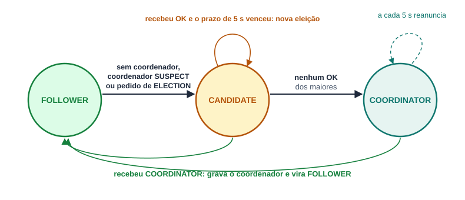
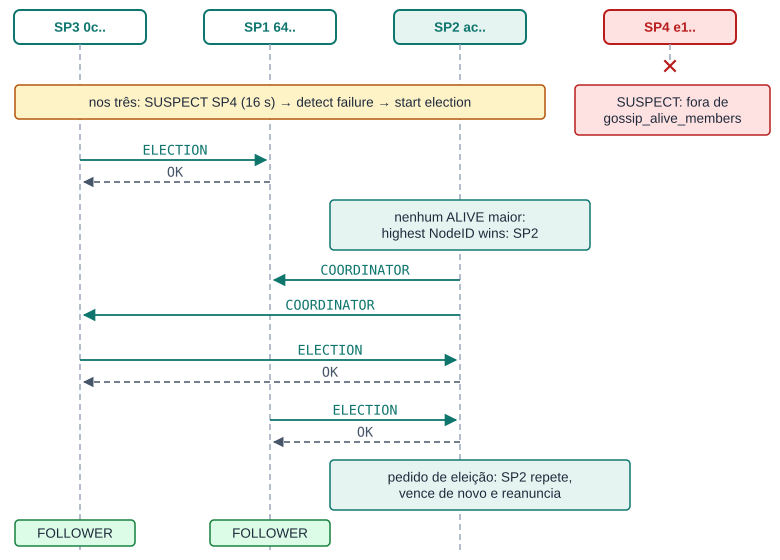
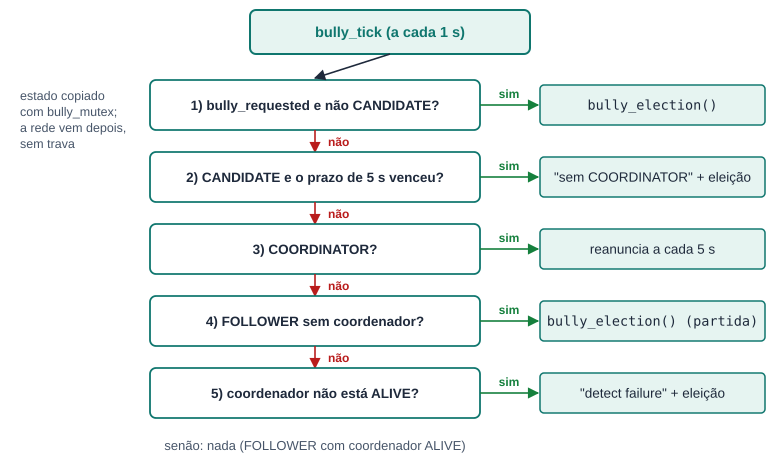
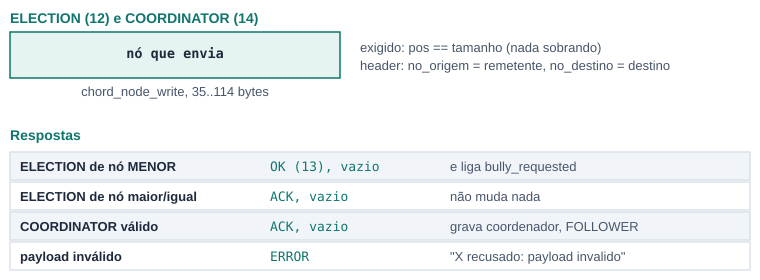

# Eleição Bully entre os Super Peers

*Programação Distribuída · Checkpoint 4 · Aluno 1*

**Como os Super Peers escolhem um novo coordenador**

| | |
|---|---|
| Branch | `checkpoint-4` |
| Base | `unificacao-checkpoint-3 (6939811)` |
| Teste C4 | PASS 4, FAIL 0 (script do professor, rodado para este documento) |
| Testes anteriores | C2 PASS 4, FAIL 0 · C3 PASS 5, FAIL 0 |

Cores dos diagramas: cinza = seção comum / base, verde = Aluno 1 (Bully), azul = Aluno 2 (log SMR).

## Sumário

1. Parte 1. Seção comum: sistema, arquivos e compilação, threads e mutexes, ordem do main e c4.conf, protocolo, como as partes se encaixam, teste do C4
2. Parte 2. Aluno 1: ideia e decisões, estruturas, máquina de estados, execução da eleição, mensagens ELECTION, OK e COORDINATOR, todas as funções do bully.c, consultas do gossip e código no superpeer.c, o que mudou em relação ao CP3, observações, log real

---

# Parte 1. Seção comum

*O que os dois alunos precisam saber do código inteiro do Checkpoint 4. Esta parte é idêntica nos dois documentos.*

## 1.1 O sistema no Checkpoint 4

No Checkpoint 3 os Super Peers passaram a se conhecer: o **anel Chord** (`chord.c`) e a **membership com heartbeat e gossip** (`gossip.c`), que marca quem parou de responder como SUSPECT, FAILED e REMOVED. No Checkpoint 4 eles passam a **concordar sobre o banco de metadados**:

- **[Aluno 1]** **Eleição Bully** (`bully.c`): os Super Peers escolhem um **coordenador**, o de maior NodeID entre os vivos. Quando o coordenador cai (o gossip o marca como SUSPECT), os outros fazem uma nova eleição com `ELECTION`, `OK` e `COORDINATOR`.
- **[Aluno 2]** **Log de operações SMR** (`smr.c`): todo STORE passa pelo coordenador, que cria uma entrada de log (`LOG #n`) com TransactionID, versão, relógio lógico e checksum, aplica e manda a entrada a cada Super Peer vivo (`LOG_APPEND`). Todos aplicam as mesmas entradas, na mesma ordem.


**Figura 1.** Os 4 Super Peers do teste. O peer fala com o SP em que fez JOIN; o STORE é repassado ao coordenador, que replica a entrada para todos.

Os nomes `SP1` a `SP4` vêm do arquivo `tests/config/c4.conf`. A prioridade do Bully é o NodeID (Seção 15.2), e não a ordem do arquivo. No teste a ordem ficou `SP4 (e1..) > SP2 (ac..) > SP1 (64..) > SP3 (0c..)`; por isso o SP4 é o primeiro coordenador e o SP2 assume quando o SP4 cai.

## 1.2 Arquivos, responsáveis e compilação

| Arquivo | Responsável | O que faz no CP4 |
|---|---|---|
| `bully.c`, `include/bully.h` | **[Aluno 1]** | Novo. Estado da eleição, thread periódica, handlers de ELECTION e COORDINATOR, `bully_get_coordinator`. |
| `smr.c`, `include/smr.h` | **[Aluno 2]** | Novo. Log em memória, TransactionID, Lamport, checksum, `smr_put` no coordenador e `smr_handle_log_append` nos followers. |
| `gossip.c`, `include/gossip.h` | **[Aluno 1]** | Duas consultas novas: `gossip_alive_members` e `gossip_member_state`. O `enum GossipState` foi para o header. |
| `superpeer.c` | os dois | `tratar_bully` e `bully_start` (Aluno 1); `tratar_store` com repasse, `tratar_log_append` e `smr_start` (Aluno 2); leitura do `c4.conf` em CSV (comum). |
| `protocol.c`, `include/protocol.h` | **[Aluno 2]** | `MSG_LOG_APPEND = 26` e os nomes ELECTION, OK, COORDINATOR e LOG_APPEND em `nome_do_tipo`. |
| `Makefile` | os dois | `bully.o` e `smr.o` no superpeer e as dependências de header. |
| `chord.c`, `metadata.c`, `node.c`, `network.c`, `peer.c` | base | **Não mudaram.** O CP4 só usa as funções públicas deles. |

```makefile
# Makefile: dois objetos novos, so no superpeer
SUPERPEER_OBJS = build/superpeer.o build/node.o build/protocol.o build/network.o \
                 build/metadata.o build/chord.o build/gossip.o build/bully.o build/smr.o
build/bully.o: include/bully.h include/chord.h include/gossip.h include/node.h include/network.h \
               include/protocol.h include/smr.h include/metadata.h
build/smr.o: include/smr.h include/metadata.h include/bully.h include/chord.h include/gossip.h \
             include/node.h include/network.h include/protocol.h
```

Compilação usada (zero warnings nos arquivos do CP4 e zero erros do sanitizer):

```text
make clean && make CFLAGS="-Wall -Wextra -Wpedantic -fsanitize=address,undefined -g -O1 -pthread"
```

Os únicos warnings da compilação são do `peer.c` (`SHA256_Init` obsoleto, `fread`, truncamento de `%s`). Eles já existiam no CP3, e o `peer.c` não faz parte do CP4.


**Figura 2.** Quem usa quem. Bully e SMR dependem um do outro só por duas funções: o SMR pergunta quem é o coordenador e o Bully pergunta qual é o próximo `LOG #`.

## 1.3 Threads e mutexes do Super Peer

O CP4 acrescenta **uma thread** (a do Bully) e **três mutexes** (`bully_mutex`, `smr_mutex` e `smr_order_mutex`).


**Figura 3.** Threads (em cima) e o estado que cada uma toca (embaixo).

- **main**: só aceita conexões e cria uma thread por conexão.
- **thread do Chord** e **thread do Gossip**: iguais ao CP3.
- **thread do Bully** **[Aluno 1]**: espera 10 s (a membership já tem os vizinhos) e depois, a cada 1 s, decide se precisa de eleição ou de reanunciar o coordenador.
- **thread por conexão**: recebe uma mensagem, chama o handler e responde. É nela que roda o `smr_put` **[Aluno 2]**, quando o STORE chega ao coordenador.

> **A regra que os dois seguem, e a única exceção**
>
> Nenhum mutex fica travado durante uma chamada de rede: **trava, copia, solta, conversa, trava de novo para gravar**. A exceção é o `smr_order_mutex`: ele fica travado do começo ao fim do `smr_put`, inclusive durante os `LOG_APPEND` aos followers, para que dois STORE simultâneos não se misturem. Não há deadlock porque o tratamento de `LOG_APPEND` nunca trava esse mutex, e porque o coordenador não manda `LOG_APPEND` para si mesmo.

## 1.4 A ordem de execução do `main`


**Figura 4.** Ordem do `main` em `superpeer.c:838`. Os dois passos novos ficam depois do `gossip_start`.

1. Leitura das opções e do `--config`, como no CP3. O arquivo agora pode estar em **chave=valor** (`c3.conf`) ou em **CSV** (`c4.conf`, veja abaixo).
2. `node_init`, `criar_servidor`, `chord_start` e `gossip_start`, como no CP3.
3. `smr_start(&superpeer)` **[Aluno 2]**: guarda o NodeID e imprime `SMR: log de operacoes em memoria (ate 1024 entradas)`.
4. `bully_start(&superpeer, nome)` **[Aluno 1]**: guarda o nó e cria a thread do Bully. Imprime `Bully: eleicao em 10 s, espera de COORDINATOR de 5 s`.
5. Laço de `accept`. Se `smr_start` ou `bully_start` falhar, o `main` imprime o erro, fecha o socket e sai (`superpeer.c:889`).

### O `c4.conf` em CSV

O arquivo do teste do professor tem uma linha por Super Peer, e nenhuma chave `bootstrap=`:

```text
SP1,superpeer,127.0.0.1,5101,00000001,1
SP2,superpeer,127.0.0.1,5102,00000002,2
SP3,superpeer,127.0.0.1,5103,00000003,3
SP4,superpeer,127.0.0.1,5104,00000004,4
```

#### `ler_linha_csv` · `superpeer.c:711`

**Thread:** main · **Mutex:** não · **Rede:** não · **Log:** Erro: linha invalida (stderr)

Chamada pelo `ler_config` para toda linha sem `=` que não é comentário. Lê os quatro primeiros campos com `sscanf("%63[^,],%15[^,],%15[^,],%7[^,]")`: os tamanhos limitados impedem estouro dos buffers. Linha que não tem os quatro campos é ignorada.

1. Se ainda não há bootstrap (`config->superpeer_port == 0`), a linha vira o bootstrap: monta `"ip:porta"` e passa por `ler_bootstrap`, que valida IP e porta. Na prática, a primeira linha (o SP1) é o bootstrap de todos.
2. Se o nome não veio por `--name` e a porta da linha é a deste nó, o nome da linha vira o nome do nó (`SP1` a `SP4`).

O UUID e a última coluna (prioridade) são ignorados: o UUID continua no arquivo `superpeer_<porta>.uuid`, e a prioridade do Bully é o NodeID.

## 1.5 Protocolo: o que mudou


**Figura 5.** O cabeçalho é o mesmo do CP3 (`include/protocol.h`).

| Código | Mensagem | Quem usa | Desde |
|---|---|---|---|
| 1 a 4 | JOIN, LEAVE, LOOKUP, STORE | Peer → Super Peer (STORE também SP → coordenador) | CP1, CP2; repasse no CP4 |
| 10, 11 | HEARTBEAT, GOSSIP | Super Peer → Super Peer | CP3 |
| 12 | ELECTION | Super Peer → Super Peer de NodeID maior | **[CP4 Aluno 1]** |
| 13 | OK | resposta ao ELECTION, vazia | **[CP4 Aluno 1]** |
| 14 | COORDINATOR | coordenador → todos os vivos | **[CP4 Aluno 1]** |
| 17, 18 | ACK, ERROR | respostas | CP1 |
| 21 a 25 | FIND_SUCCESSOR ... TOPOLOGY | Chord | CP3 |
| 26 | LOG_APPEND | coordenador → followers | **[CP4 Aluno 2]** |

Os códigos 12 a 14 já existiam no enum desde o CP1, sem uso. O 26 foi acrescentado depois do `MSG_TOPOLOGY = 25`. Os quatro nomes entraram em `nome_do_tipo`, então o log mostra `RX ELECTION de ...` em vez de `RX UNKNOWN`.

Como no CP3, todo pedido entre Super Peers **abre uma conexão, envia, espera a resposta e fecha**.

### O nó serializado

ELECTION e COORDINATOR levam no payload o nó que envia, no mesmo formato do Chord e do gossip (`chord_node_write` / `chord_node_read`):


**Figura 6.** Formato de um nó na rede (igual ao CP3).

### Despacho em `atender_conexao`


**Figura 7.** O `switch` ganhou dois handlers (`superpeer.c:660` e `superpeer.c:664`), e o `tratar_store` mudou.

Os handlers novos usam `validar_chord` (versão 1 e `no_origem` não zerado), a mesma validação das mensagens entre Super Peers do CP3.

## 1.6 Como as duas partes se encaixam

> **Bully (Aluno 1)**
>
> Responde "*quem é o coordenador?*" com `bully_get_coordinator`. Detecta a queda do coordenador pela membership do gossip e elege outro.

> **Log SMR (Aluno 2)**
>
> Responde "*em que ordem aplicar?*". Só o coordenador cria entradas; os followers só aceitam `LOG_APPEND` de quem o Bully diz ser o coordenador.

O caminho de um STORE junta as duas partes:


**Figura 8.** STORE feito no SP1 com o SP4 como coordenador. A barra azul é o tempo em que o `smr_order_mutex` fica travado.

1. O peer faz JOIN no SP1 e manda o STORE para ele. O SP1 valida como no CP2 (`validar_origem`: o peer precisa ter feito JOIN ali) e desserializa o metadado.
2. O SP1 não é o coordenador: repassa **a mesma mensagem** ao coordenador, trocando só o `no_destino` pelo NodeID do coordenador. O `no_origem` continua sendo o peer, que é o dono do arquivo.
3. O coordenador vê `no_destino` igual ao seu NodeID, entende que é um STORE repassado e pula a checagem de JOIN (o peer não fez JOIN nele). Chama `smr_put`, que cria `LOG #1`, aplica e manda `LOG_APPEND` a cada Super Peer vivo, um de cada vez.
4. A resposta do coordenador (ACK ou ERROR) volta ao SP1, que a devolve ao peer.

Pontos de contato no código:

- O **SMR usa o Bully** em dois lugares: `tratar_store` pergunta se este nó é o coordenador, e `smr_handle_log_append` só aceita `LOG_APPEND` cujo `no_origem` é o coordenador atual.
- O **Bully usa o SMR** em um lugar: ao assumir, imprime `resume operations (proximo LOG #n)` com `smr_last_applied() + 1`.
- Os dois usam a **membership do gossip** pelas consultas novas: o Bully para saber quem está vivo e se o coordenador caiu, o SMR para saber a quem mandar o `LOG_APPEND`.

## 1.7 O teste do Checkpoint 4 (`tests/c4/run.sh`)

O teste é o **script fornecido pelo professor**, usado sem alteração. Ele sobe os 4 Super Peers com `--config tests/config/c4.conf --port 510X`, todos escrevendo no mesmo `c4.log`, mata o SP4 aos 8 s e confere o log 19 s depois.


**Figura 9.** Linha do tempo do teste e qual aluno cobre cada checagem.

O SP4 morre **antes** da primeira eleição (o Bully espera 10 s). Aos 10 s os três vivos não têm coordenador, fazem a eleição, e o SP2 vence. Os comandos `--cmd put` e `--cmd state` do script não existem no `peer.c`, que manda um PING no lugar; o teste não depende da resposta deles.

Resultado na branch `checkpoint-4` (rodado para este documento): **PASS 4, FAIL 0**. Os testes anteriores continuam iguais: `tests/run.sh` (CP2) **PASS 4, FAIL 0** e `tests/c3/run.sh` (CP3) **PASS 5, FAIL 0**.

```text
==== C4 — Bully + SMR ====
[PASS] Eleição foi iniciada
[PASS] Novo coordenador foi anunciado
[PASS] Há evidência de SMR/log
[PASS] Sem crash/deadlock reportado em c4.log
PASS: 4
FAIL: 0
```

Trecho real do `c4.log` (os 4 processos escrevem misturados no mesmo arquivo):

```text
SMR: log de operacoes em memoria (ate 1024 entradas)
Bully: eleicao em 10 s, espera de COORDINATOR de 5 s
...
Chord: SP4 nao respondeu
start election
ELECTION -> SP4
ELECTION -> SP2
start election
ELECTION -> SP4
highest NodeID wins: SP2
COORDINATOR SP2
...
Coordenador: SP2 (este no)
resume operations (proximo LOG #1)
```

### Teste manual com upload

O script do professor não faz upload. Para mostrar o log replicado e a eleição **depois** de um coordenador já eleito, foi feito também um teste manual com os mesmos 4 Super Peers:

1. Sobe SP1 a SP4 e espera 15 s. O SP4 é eleito.
2. No SP1: `bin/client --cmd join` e `bin/client --cmd upload --file tests/data/documento_a.pdf`. O `LOG #1` aparece nos 4 logs.
3. `kill -9` no SP4 e espera 23 s (15 s de timeout do gossip + 5 s do Bully + 3 s).
4. No SP1: join e upload de `documento_b.pdf`. O `LOG #2` aparece nos 3 sobreviventes.
5. As linhas `LOG #`, `PUT` e `ObjectID` são idênticas nos 3 sobreviventes (mesmo `md5sum`), e nenhum log tem erro do AddressSanitizer.

---

# Parte 2. Aluno 1: Eleição Bully

*Arquivo principal `bully.c` (309 linhas, novo) e `include/bully.h`. Também: as duas consultas novas em `gossip.c`, e `tratar_bully` e `bully_start` em `superpeer.c`.*

## 2.1 A ideia em uma página

A Seção 16.9 pede que, quando o coordenador morre, os Super Peers elejam outro com as mensagens `ELECTION`, `OK` e `COORDINATOR`. A prioridade é o NodeID e o maior vence (Seção 15.2). O `bully.c` faz isso em três partes:

1. **Eleição.** O nó vira CANDIDATE e manda `ELECTION` a cada membro vivo com NodeID maior que o seu. Se algum responde `OK`, existe alguém maior: o nó espera o `COORDINATOR` por até 5 s, e recomeça se ele não chegar. Se ninguém responde OK, o nó é o maior vivo: vira COORDINATOR e manda `COORDINATOR` a todos.
2. **Resposta a outros.** Quem recebe `ELECTION` de um nó menor responde `OK` e inicia a própria eleição. Quem recebe `COORDINATOR` grava o coordenador e vira FOLLOWER.
3. **Vigilância.** Uma thread confere a cada 1 s se o coordenador ainda está ALIVE na membership do gossip. Se não está, imprime `detect failure` e começa uma eleição. O coordenador reenvia `COORDINATOR` a cada 5 s, para quem entrou depois saber quem é.

A detecção de falha **não** é feita pelo Bully: ele confia no gossip do CP3 (Seção 15.8, "o Gossip confirma a suspeita de falha antes da eleição"). Quem perde 15 s de heartbeat vira SUSPECT, e só então há eleição. Isso evita eleições por um atraso pequeno da rede.

### Decisões de projeto

| Decisão | Por quê |
|---|---|
| Eleição quando o coordenador fica **SUSPECT** | É o primeiro estado de falha do gossip (15 s sem heartbeat). Esperar FAILED (30 s) deixaria o sistema sem coordenador por mais tempo. |
| **Maior NodeID vence** | Seção 15.2 (`Priority = NodeID`). Comparação com `node_id_compare`, que trata os 32 bytes como número big-endian. |
| Participantes = membros **ALIVE** do gossip | Um nó SUSPECT, FAILED ou REMOVED não recebe ELECTION. Assim a eleição não espera um nó que já se sabe morto. |
| Espera inicial de **10 s** | Na partida o gossip ainda está descobrindo os vizinhos. Com 10 s a membership já tem todos (a descoberta leva 5 a 10 s no CP3). |
| **Reanúncio a cada 5 s** | Quem entra depois, ou quem volta (Seção 15.7), recebe o `COORDINATOR` e entra como FOLLOWER sem precisar de nova eleição. |
| A eleição roda **na thread do Bully** | O handler de ELECTION só responde OK e liga um pedido (`bully_requested`). A conexão termina na hora e a eleição, que usa rede e pode esperar 5 s, roda na thread periódica. |
| Mutex só para copiar o estado | Igual ao CP3: nenhuma chamada de rede com `bully_mutex` travado. |

## 2.2 Estruturas e constantes

```c
/* include/bully.h */
#define BULLY_WAIT_SEC 5        /* espera do COORDINATOR depois de um OK */
#define BULLY_PERIOD_SEC 1      /* tick da thread */
#define BULLY_START_SEC 10      /* espera inicial */
#define BULLY_ANNOUNCE_SEC 5    /* reanúncio do coordenador */
typedef enum { BULLY_FOLLOWER, BULLY_CANDIDATE, BULLY_COORDINATOR } BullyState;

/* bully.c */
#define BULLY_MAX 64            /* membros consultados por vez */
static ChordNode bully_self;               /* este nó */
static ChordNode bully_coord;              /* coordenador atual */
static int bully_has_coord = 0;            /* 0 = sem coordenador */
static BullyState bully_state = BULLY_FOLLOWER;
static int bully_requested = 0;            /* pedido de eleição vindo do handler */
static time_t bully_deadline = 0;          /* prazo para o COORDINATOR (0 = sem prazo) */
static pthread_mutex_t bully_mutex = PTHREAD_MUTEX_INITIALIZER;
```

`bully_self` é escrito uma vez em `bully_start`, antes de a thread existir, e depois só é lido; por isso é lido sem mutex (igual ao `chord_self` do CP3). Todo o resto é lido e escrito com `bully_mutex`. A thread trabalha sobre uma cópia (`BullySnapshot`) para não segurar o mutex durante a rede.

## 2.3 Máquina de estados



**Figura 10.** Os três estados da Seção 15.3 e o que faz o nó mudar de um para outro.

| Transição | Quando | Quem faz | Log |
|---|---|---|---|
| FOLLOWER → CANDIDATE | sem coordenador, coordenador não ALIVE, ou pedido de ELECTION | `bully_election` | `start election` |
| CANDIDATE → COORDINATOR | nenhum nó maior respondeu OK | `bully_become_coordinator` | `highest NodeID wins: SP2` |
| CANDIDATE → CANDIDATE | recebeu OK e o prazo de 5 s venceu | `bully_tick` | `sem COORDINATOR, nova eleicao` |
| qualquer → FOLLOWER | chegou COORDINATOR | `bully_handle_coordinator` | `COORDINATOR SP2` |
| COORDINATOR → COORDINATOR | a cada 5 s | `bully_tick` → `bully_announce` | não imprime |

Um nó que **volta** sobe como FOLLOWER sem coordenador. Se em 10 s chegar o reanúncio do coordenador atual, ele fica FOLLOWER (Seção 15.7).

## 2.4 Execução: a eleição depois da queda do coordenador



**Figura 11.** Teste manual: o SP4 (coordenador) leva `kill -9`. A ordem das mensagens é a do log real.

1. O SP4 para de mandar heartbeat. Cerca de 16 s depois, o gossip de cada sobrevivente o marca como SUSPECT.
2. No tick seguinte, o Bully de cada um vê que o coordenador não está ALIVE, imprime `detect failure: SP4 (coordenador)` e começa uma eleição.
3. O SP4 já está SUSPECT, então **não** entra na lista de `gossip_alive_members`: ninguém manda ELECTION para ele.
4. O SP3 (menor) manda ELECTION para SP1 e SP2 e recebe OK dos dois. O SP1 manda para o SP2 e recebe OK.
5. O SP2 não tem nenhum ALIVE maior: vence, manda COORDINATOR ao SP1 e ao SP3 e imprime `resume operations (proximo LOG #2)`.
6. Os ELECTION que chegaram ao SP2 ligaram `bully_requested`, então ele repete a eleição, vence de novo e reanuncia. Isso é o comportamento normal do Bully e não muda o resultado.

No **teste do professor** o caso é diferente: o SP4 morre aos 8 s, antes de qualquer eleição, e aos 10 s ainda está ALIVE no gossip. Por isso o log mostra `ELECTION -> SP4`: a conexão é recusada (conta como "sem OK") e a eleição segue para os outros.

### O tick de 1 segundo



**Figura 12.** As cinco perguntas de `bully_tick`, na ordem do código. A primeira que der "sim" decide o que acontece no segundo.

## 2.5 Mensagens ELECTION, OK e COORDINATOR



**Figura 13.** Payloads e respostas. "nó" é o formato da Figura 6.

- ELECTION e COORDINATOR carregam o mesmo payload: o nó que envia, escrito por `chord_node_write`. Quem recebe usa `chord_node_read` e exige que não sobre nenhum byte (`pos == tamanho`).
- OK é uma resposta vazia do tipo `MSG_OK`, na mesma conexão do ELECTION. Não abre conexão nova.
- O header segue o CP3: `no_origem` é o remetente, `no_destino` é o destino, `timestamp` é a hora.

## 2.6 Função por função: `bully.c`

*Legenda das fichas: **Thread** = quem executa; **Mutex** = se trava `bully_mutex`; **Rede** = mensagens trocadas; **Log** = o que imprime.*

### Início

#### `bully_start` · `bully.c:226`

**Thread:** main · **Mutex:** não (ainda não há outra thread) · **Rede:** não · **Log:** Bully: eleicao em 10 s, espera de COORDINATOR de 5 s

Chamada pelo `main` logo depois de `smr_start`. Preenche `bully_self` com NodeID, IP, porta e nome do nó, imprime a configuração e cria a thread `bully_loop` com `pthread_detach`. Se o `pthread_create` falhar, devolve -1 e o `main` encerra.

#### `bully_loop` · `bully.c:212`

**Thread:** thread Bully · **Mutex:** indireto · **Rede:** indireto · **Log:** não

```c
sleep(BULLY_START_SEC);               /* 10 s: a membership se forma */
for (;;) {
    bully_tick(&ultimo_anuncio);
    sleep(BULLY_PERIOD_SEC);          /* 1 s */
}
```

> Não existe um caso separado de "partida": depois dos 10 s, um nó sem coordenador cai na regra 4 do tick (FOLLOWER sem coordenador) e faz a eleição.

### Decisão periódica

#### `bully_tick` · `bully.c:181`

**Thread:** thread Bully · **Mutex:** só na cópia · **Rede:** indireto · **Log:** sem COORDINATOR, nova eleicao / detect failure: X (coordenador)

Copia o estado com `bully_snapshot` e aplica a primeira regra que vale (Figura 12):

1. Há pedido de eleição e o nó não é CANDIDATE: `bully_election`.
2. É CANDIDATE, tem prazo e o prazo venceu: imprime `sem COORDINATOR, nova eleicao` e repete a eleição.
3. É COORDINATOR: se já passaram 5 s desde o último anúncio, chama `bully_announce` e guarda a hora.
4. É FOLLOWER sem coordenador: `bully_election`.
5. O coordenador é outro nó e `bully_coord_alive` diz que não está ALIVE: imprime `detect failure`, apaga o coordenador e faz a eleição.

#### `bully_snapshot` · `bully.c:78`

**Thread:** thread Bully · **Mutex:** sim · **Rede:** não · **Log:** não

Trava, copia estado, coordenador, pedido e prazo para um `BullySnapshot` e solta.

#### `bully_coord_alive` · `bully.c:175`

**Thread:** thread Bully · **Mutex:** não (o gossip trava o dele) · **Rede:** não · **Log:** não

Devolve 1 só se `gossip_member_state(coord->id)` é `GOSSIP_ALIVE`. SUSPECT, FAILED, REMOVED ou -1 (não está na membership) contam como queda.

### Eleição

#### `bully_election` · `bully.c:136`

**Thread:** thread Bully · **Mutex:** só para mudar o estado · **Rede:** ELECTION → OK · **Log:** start election / ELECTION -> X / OK <- X

1. `bully_set(CANDIDATE, NULL, 0)`: vira candidato, apaga o coordenador e limpa o pedido.
2. Copia os membros ALIVE com `gossip_alive_members`.
3. Para cada um com NodeID **maior** que o seu: imprime `ELECTION -> X` e chama `bully_request(MSG_ELECTION)`. Se a resposta for `MSG_OK`, imprime `OK <- X` e marca que recebeu OK.
4. Sem nenhum OK: `bully_become_coordinator`.
5. Com OK: trava e, **se ainda for CANDIDATE**, marca o prazo de agora + 5 s. Se um COORDINATOR chegou durante o passo 3, o nó já é FOLLOWER e não marca prazo.

> Um nó que não responde (conexão recusada) conta como "sem OK". É o que acontece com o SP4 no teste do professor.

#### `bully_become_coordinator` · `bully.c:124`

**Thread:** thread Bully · **Mutex:** só para mudar o estado · **Rede:** COORDINATOR × N · **Log:** highest NodeID wins / COORDINATOR X / Coordenador: X (este no) / resume operations

Grava a si mesmo como coordenador e vira COORDINATOR. Imprime `highest NodeID wins: SP2` e `COORDINATOR SP2`, manda o anúncio a todos os ALIVE com `bully_announce` e depois imprime `Coordenador: SP2 (este no)` e `resume operations (proximo LOG #n)`, com `n = smr_last_applied() + 1` (Aluno 2).

#### `bully_announce` · `bully.c:111`

**Thread:** thread Bully · **Mutex:** não (o gossip trava o dele) · **Rede:** COORDINATOR → ACK · **Log:** não

Copia os membros ALIVE e manda `COORDINATOR` a cada um com `bully_request`. Ignora a resposta: quem não responde recebe o próximo reanúncio, 5 s depois.

#### `bully_request` · `bully.c:40`

**Thread:** thread Bully · **Mutex:** não · **Rede:** uma conexão por pedido · **Log:** não

O "RPC" do Bully, igual em estrutura ao `gossip_request` do CP3.

1. `conectar_no_servidor(ip, porta)`. Se falhar, devolve -1.
2. Monta o Header (versão 1, tipo, `no_origem = bully_self.id`, `no_destino`, timestamp) e o payload com `chord_node_write(&bully_self)` num buffer de `CHORD_NODE_MAX` bytes na pilha.
3. `enviar_mensagem`, `receber_mensagem` e `close` (sempre).
4. Se deu certo, devolve o tipo da resposta em `*tipo_resposta` e libera o payload da resposta.

#### `bully_set` · `bully.c:93`

**Thread:** thread Bully · **Mutex:** sim · **Rede:** não · **Log:** não

Trava e grava estado, prazo e coordenador (`coord == NULL` apaga), e zera `bully_requested`. Usada nas transições feitas pela própria thread.

### Recepção (chamadas pelo `superpeer.c`)

#### `bully_handle_election` · `bully.c:246`

**Thread:** thread de conexão · **Mutex:** sim · **Rede:** não (a resposta é do `tratar_bully`) · **Log:** não

Lê o nó com `chord_node_read` e exige `pos == tamanho`. Se o remetente tem NodeID **maior ou igual**, devolve 0 (o `tratar_bully` responde ACK). Se é **menor**, trava, liga `bully_requested` se o nó não for CANDIDATE, solta e devolve 1 (o `tratar_bully` responde OK). Payload inválido devolve -1 (ERROR).

> A eleição não roda aqui. O handler só deixa o pedido; a thread do Bully começa a eleição em até 1 s. Assim a conexão do outro nó é respondida na hora.

#### `bully_handle_coordinator` · `bully.c:268`

**Thread:** thread de conexão · **Mutex:** sim · **Rede:** não · **Log:** COORDINATOR X / Coordenador: X

Lê e valida o nó como acima. Trava, grava o coordenador, vira FOLLOWER, zera o prazo e o pedido. Só imprime as duas linhas se algo mudou (outro coordenador, ou este nó não era FOLLOWER); assim o reanúncio de 5 s não enche o log.

#### `bully_get_coordinator` · `bully.c:296`

**Thread:** thread de conexão (SMR) · **Mutex:** sim · **Rede:** não · **Log:** não

Copia o coordenador em `*out` e devolve 1, ou devolve 0 se não há coordenador. É a função que o Aluno 2 usa no `tratar_store` e no `smr_handle_log_append`.

## 2.7 Código do Aluno 1 fora do `bully.c`

### gossip.c: duas consultas novas

#### `gossip_alive_members` · `gossip.c:439`

**Thread:** thread Bully e thread de conexão (SMR) · **Mutex:** gossip_mutex · **Rede:** não · **Log:** não

Trava a membership e copia para `out` (até `max`) os membros com estado `GOSSIP_ALIVE`. O próprio nó nunca está na tabela do gossip, então não aparece. Devolve quantos copiou (0 se `out` é NULL, `max <= 0` ou o lock falhar).

#### `gossip_member_state` · `gossip.c:457`

**Thread:** thread Bully · **Mutex:** gossip_mutex · **Rede:** não · **Log:** não

Procura o NodeID com `gossip_find` (função do CP3) e devolve o estado (0 a 3), ou -1 se o nó não está na membership.

Para o Bully comparar o retorno com `GOSSIP_ALIVE`, o `enum GossipState` saiu do `gossip.c` e foi para `include/gossip.h`, com os mesmos valores. O `gossip.h` passou a incluir `chord.h` (por causa do `ChordNode` em `gossip_alive_members`).

### superpeer.c

#### `tratar_bully` · `superpeer.c:581`

**Thread:** thread de conexão · **Mutex:** não · **Rede:** responde OK, ACK ou ERROR · **Log:** X recusado: payload invalido

1. `validar_chord` (versão 1, origem não zerada). Falhou: `ERROR`.
2. ELECTION → `bully_handle_election`. Retorno 1 vira `MSG_OK`; retorno 0 vira `ACK`.
3. COORDINATOR → `bully_handle_coordinator`. Sucesso vira `ACK`.
4. Retorno negativo: imprime `X recusado: payload invalido` e responde `ERROR`.

No `atender_conexao` entraram os casos `MSG_ELECTION` e `MSG_COORDINATOR`, e no `main` a chamada `bully_start(&superpeer, nome)`.

## 2.8 O que mudou em relação ao CP3

Base de comparação: branch `unificacao-checkpoint-3`, commit `6939811`. O CP4 foi feito direto na branch `checkpoint-4`, criada a partir dela.

| Arquivo |  | Mudança |
|---|---|---|
| `bully.c` | **[novo]** | Arquivo inteiro: estado, thread, eleição, handlers. |
| `include/bully.h` | **[novo]** | Constantes, `BullyState` e as cinco funções públicas. |
| `gossip.c` | **[alterado]** | `gossip_alive_members` e `gossip_member_state` no fim do arquivo; `enum GossipState` saiu para o header. Nada mais mudou. |
| `include/gossip.h` | **[alterado]** | `GossipState`, `#include "chord.h"` e as duas declarações novas. |
| `superpeer.c` | **[alterado]** | `tratar_bully`, casos 12 e 14 no despacho, `bully_start` no `main`. |
| `Makefile` | **[alterado]** | `build/bully.o` no superpeer e a regra de dependências dele. |

```diff
@@ include/gossip.h @@
+#include "chord.h"
+typedef enum {
+    GOSSIP_ALIVE = 0, GOSSIP_SUSPECT = 1, GOSSIP_FAILED = 2, GOSSIP_REMOVED = 3
+} GossipState;
+int gossip_alive_members(ChordNode *out, int max);
+int gossip_member_state(const uint8_t id[NODE_ID_LEN]);
@@ superpeer.c: atender_conexao @@
+        case MSG_ELECTION:
+        case MSG_COORDINATOR:
+            tratar_bully(&conexao, &msg);
+            break;
@@ superpeer.c: main @@
+    if (smr_start(&superpeer) != 0 || bully_start(&superpeer, nome) != 0) {
+        fprintf(stderr, "Erro: nao foi possivel iniciar o Bully e o SMR\n");
```

## 2.9 Observações sobre o comportamento atual

> **Pontos que vale conhecer (não quebram o teste)**
>
> - **Eleição repetida no novo coordenador.** Cada ELECTION recebido de um nó menor liga `bully_requested`, mesmo se este nó já é COORDINATOR. Ele repete a eleição, vence de novo e reanuncia; no log aparece `Coordenador: SP2 (este no)` duas vezes. O resultado não muda.
> - **COORDINATOR é sempre aceito.** Quem recebe COORDINATOR grava o remetente mesmo se ele tiver NodeID menor. É o que permite a quem volta entrar como FOLLOWER (Seção 15.7), mas também quer dizer que, se a membership estiver incompleta na partida, dois nós podem se anunciar. Os 10 s de espera inicial servem para evitar isso.
> - **Volta do coordenador antigo não foi testada.** Pelo CP3, quem reinicia volta com o contador de heartbeat em 1, e os outros ignoram os heartbeats dele até o contador passar o valor antigo. Enquanto isso ele não está ALIVE para o coordenador atual, não recebe o reanúncio e, depois de 10 s, faz a própria eleição. Se ele tiver o maior NodeID, pode voltar a ser coordenador.
> - **Super Peer sozinho.** Sem outros membros, o nó só vira coordenador 10 s depois de subir. Um STORE antes disso recebe ERROR com `STORE: sem coordenador`.
> - **Sem timeout de socket.** Como no CP3, um nó que aceita a conexão e não responde travaria a thread do Bully. Com `kill -9` em localhost a conexão é recusada na hora.

## 2.10 Log real da parte do Aluno 1

Do teste manual, no SP2 (que vira o coordenador):

```text
Bully: eleicao em 10 s, espera de COORDINATOR de 5 s
start election
ELECTION -> SP4
OK <- SP4
COORDINATOR SP4
Coordenador: SP4
...
SUSPECT SP4 (127.0.0.1:5104): sem heartbeat ha 16 s
detect failure: SP4 (coordenador)
start election
highest NodeID wins: SP2
COORDINATOR SP2
RX ELECTION de 648e3b90...
RX ELECTION de 0cba4b66...
Coordenador: SP2 (este no)
resume operations (proximo LOG #2)
```

No SP3 (o menor NodeID), para a mesma queda:

```text
detect failure: SP4 (coordenador)
start election
ELECTION -> SP1
OK <- SP1
ELECTION -> SP2
RX COORDINATOR de ac1d3cf0...
COORDINATOR SP2
Coordenador: SP2
OK <- SP2
```

*O `COORDINATOR SP2` chega ao SP3 antes do `OK <- SP2` porque o SP2 já tinha decidido a eleição quando recebeu o ELECTION do SP3.*
