# Log de operações (SMR) do PUT

*Programação Distribuída · Checkpoint 4 · Aluno 2*

**LogIndex, TransactionID, versão e checksum em todos os Super Peers**

| | |
|---|---|
| Branch | `checkpoint-4` |
| Base | `unificacao-checkpoint-3 (6939811)` |
| Teste C4 | PASS 4, FAIL 0 (script do professor, rodado para este documento) |
| Testes anteriores | C2 PASS 4, FAIL 0 · C3 PASS 5, FAIL 0 |

Cores dos diagramas: cinza = seção comum / base, verde = Aluno 1 (Bully), azul = Aluno 2 (log SMR).

## Sumário

1. Parte 1. Seção comum: sistema, arquivos e compilação, threads e mutexes, ordem do main e c4.conf, protocolo, como as partes se encaixam, teste do C4
2. Parte 2. Aluno 2: ideia e decisões, estruturas, TransactionID, Lamport e checksum, execução no coordenador e no follower, mensagem LOG_APPEND, todas as funções do smr.c, STORE repassado no superpeer.c, o que mudou em relação ao CP3, observações, log real

---

# Parte 1. Seção comum

*O que os dois alunos precisam saber do código inteiro do Checkpoint 4. Esta parte é idêntica nos dois documentos.*

## 1.1 O sistema no Checkpoint 4

No Checkpoint 3 os Super Peers passaram a se conhecer: o **anel Chord** (`chord.c`) e a **membership com heartbeat e gossip** (`gossip.c`), que marca quem parou de responder como SUSPECT, FAILED e REMOVED. No Checkpoint 4 eles passam a **concordar sobre o banco de metadados**:

- **[Aluno 1]** **Eleição Bully** (`bully.c`): os Super Peers escolhem um **coordenador**, o de maior NodeID entre os vivos. Quando o coordenador cai (o gossip o marca como SUSPECT), os outros fazem uma nova eleição com `ELECTION`, `OK` e `COORDINATOR`.
- **[Aluno 2]** **Log de operações SMR** (`smr.c`): todo STORE passa pelo coordenador, que cria uma entrada de log (`LOG #n`) com TransactionID, versão, relógio lógico e checksum, aplica e manda a entrada a cada Super Peer vivo (`LOG_APPEND`). Todos aplicam as mesmas entradas, na mesma ordem.

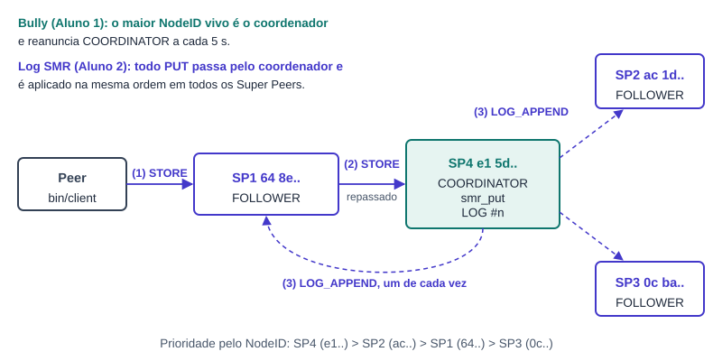

**Figura 1.** Os 4 Super Peers do teste. O peer fala com o SP em que fez JOIN; o STORE é repassado ao coordenador, que replica a entrada para todos.

Os nomes `SP1` a `SP4` vêm do arquivo `tests/config/c4.conf`. A prioridade do Bully é o NodeID (Seção 15.2), e não a ordem do arquivo. No teste a ordem ficou `SP4 (e1..) > SP2 (ac..) > SP1 (64..) > SP3 (0c..)`; por isso o SP4 é o primeiro coordenador e o SP2 assume quando o SP4 cai.

## 1.2 Arquivos, responsáveis e compilação

| Arquivo | Responsável | O que faz no CP4 |
|---|---|---|
| `bully.c`, `include/bully.h` | **[Aluno 1]** | Novo. Estado da eleição, thread periódica, handlers de ELECTION e COORDINATOR, `bully_get_coordinator`. |
| `smr.c`, `include/smr.h` | **[Aluno 2]** | Novo. Log em memória, TransactionID, Lamport, checksum, `smr_put` no coordenador e `smr_handle_log_append` nos followers. |
| `gossip.c`, `include/gossip.h` | **[Aluno 1]** | Duas consultas novas: `gossip_alive_members` e `gossip_member_state`. O `enum GossipState` foi para o header. |
| `superpeer.c` | os dois | `tratar_bully` e `bully_start` (Aluno 1); `tratar_store` com repasse, `tratar_log_append` e `smr_start` (Aluno 2); leitura do `c4.conf` em CSV (comum). |
| `protocol.c`, `include/protocol.h` | **[Aluno 2]** | `MSG_LOG_APPEND = 26` e os nomes ELECTION, OK, COORDINATOR e LOG_APPEND em `nome_do_tipo`. |
| `Makefile` | os dois | `bully.o` e `smr.o` no superpeer e as dependências de header. |
| `chord.c`, `metadata.c`, `node.c`, `network.c`, `peer.c` | base | **Não mudaram.** O CP4 só usa as funções públicas deles. |

```makefile
# Makefile: dois objetos novos, so no superpeer
SUPERPEER_OBJS = build/superpeer.o build/node.o build/protocol.o build/network.o \
                 build/metadata.o build/chord.o build/gossip.o build/bully.o build/smr.o
build/bully.o: include/bully.h include/chord.h include/gossip.h include/node.h include/network.h \
               include/protocol.h include/smr.h include/metadata.h
build/smr.o: include/smr.h include/metadata.h include/bully.h include/chord.h include/gossip.h \
             include/node.h include/network.h include/protocol.h
```

Compilação usada (zero warnings nos arquivos do CP4 e zero erros do sanitizer):

```text
make clean && make CFLAGS="-Wall -Wextra -Wpedantic -fsanitize=address,undefined -g -O1 -pthread"
```

Os únicos warnings da compilação são do `peer.c` (`SHA256_Init` obsoleto, `fread`, truncamento de `%s`). Eles já existiam no CP3, e o `peer.c` não faz parte do CP4.

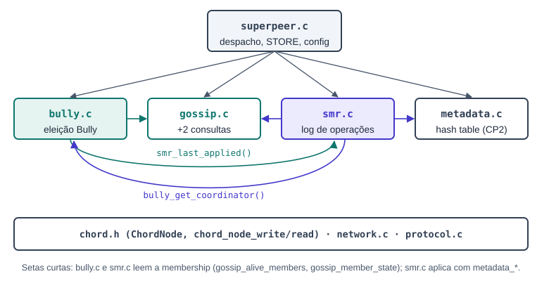

**Figura 2.** Quem usa quem. Bully e SMR dependem um do outro só por duas funções: o SMR pergunta quem é o coordenador e o Bully pergunta qual é o próximo `LOG #`.

## 1.3 Threads e mutexes do Super Peer

O CP4 acrescenta **uma thread** (a do Bully) e **três mutexes** (`bully_mutex`, `smr_mutex` e `smr_order_mutex`).

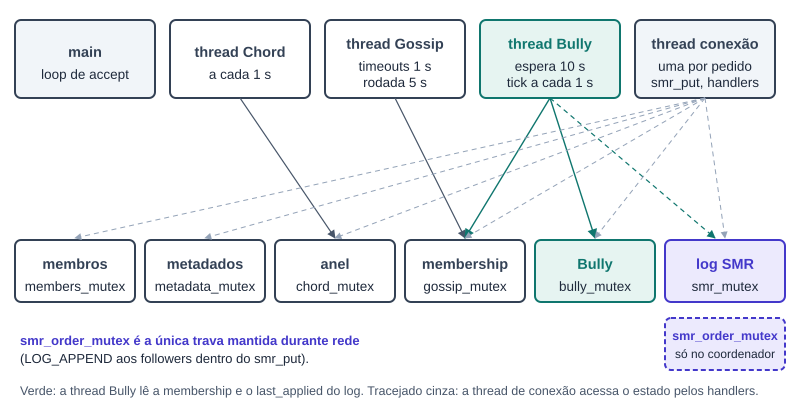

**Figura 3.** Threads (em cima) e o estado que cada uma toca (embaixo).

- **main**: só aceita conexões e cria uma thread por conexão.
- **thread do Chord** e **thread do Gossip**: iguais ao CP3.
- **thread do Bully** **[Aluno 1]**: espera 10 s (a membership já tem os vizinhos) e depois, a cada 1 s, decide se precisa de eleição ou de reanunciar o coordenador.
- **thread por conexão**: recebe uma mensagem, chama o handler e responde. É nela que roda o `smr_put` **[Aluno 2]**, quando o STORE chega ao coordenador.

> **A regra que os dois seguem, e a única exceção**
>
> Nenhum mutex fica travado durante uma chamada de rede: **trava, copia, solta, conversa, trava de novo para gravar**. A exceção é o `smr_order_mutex`: ele fica travado do começo ao fim do `smr_put`, inclusive durante os `LOG_APPEND` aos followers, para que dois STORE simultâneos não se misturem. Não há deadlock porque o tratamento de `LOG_APPEND` nunca trava esse mutex, e porque o coordenador não manda `LOG_APPEND` para si mesmo.

## 1.4 A ordem de execução do `main`

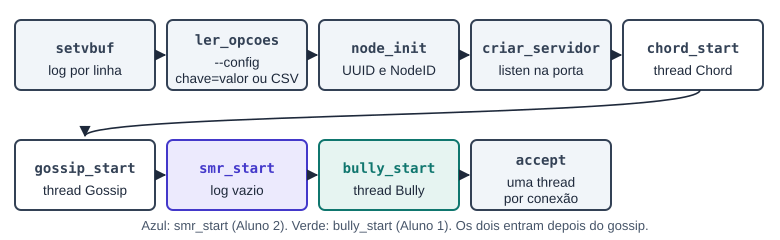

**Figura 4.** Ordem do `main` em `superpeer.c:838`. Os dois passos novos ficam depois do `gossip_start`.

1. Leitura das opções e do `--config`, como no CP3. O arquivo agora pode estar em **chave=valor** (`c3.conf`) ou em **CSV** (`c4.conf`, veja abaixo).
2. `node_init`, `criar_servidor`, `chord_start` e `gossip_start`, como no CP3.
3. `smr_start(&superpeer)` **[Aluno 2]**: guarda o NodeID e imprime `SMR: log de operacoes em memoria (ate 1024 entradas)`.
4. `bully_start(&superpeer, nome)` **[Aluno 1]**: guarda o nó e cria a thread do Bully. Imprime `Bully: eleicao em 10 s, espera de COORDINATOR de 5 s`.
5. Laço de `accept`. Se `smr_start` ou `bully_start` falhar, o `main` imprime o erro, fecha o socket e sai (`superpeer.c:889`).

### O `c4.conf` em CSV

O arquivo do teste do professor tem uma linha por Super Peer, e nenhuma chave `bootstrap=`:

```text
SP1,superpeer,127.0.0.1,5101,00000001,1
SP2,superpeer,127.0.0.1,5102,00000002,2
SP3,superpeer,127.0.0.1,5103,00000003,3
SP4,superpeer,127.0.0.1,5104,00000004,4
```

#### `ler_linha_csv` · `superpeer.c:711`

**Thread:** main · **Mutex:** não · **Rede:** não · **Log:** Erro: linha invalida (stderr)

Chamada pelo `ler_config` para toda linha sem `=` que não é comentário. Lê os quatro primeiros campos com `sscanf("%63[^,],%15[^,],%15[^,],%7[^,]")`: os tamanhos limitados impedem estouro dos buffers. Linha que não tem os quatro campos é ignorada.

1. Se ainda não há bootstrap (`config->superpeer_port == 0`), a linha vira o bootstrap: monta `"ip:porta"` e passa por `ler_bootstrap`, que valida IP e porta. Na prática, a primeira linha (o SP1) é o bootstrap de todos.
2. Se o nome não veio por `--name` e a porta da linha é a deste nó, o nome da linha vira o nome do nó (`SP1` a `SP4`).

O UUID e a última coluna (prioridade) são ignorados: o UUID continua no arquivo `superpeer_<porta>.uuid`, e a prioridade do Bully é o NodeID.

## 1.5 Protocolo: o que mudou

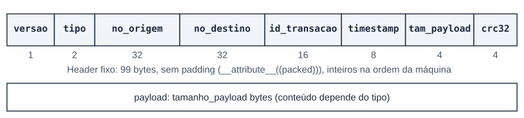

**Figura 5.** O cabeçalho é o mesmo do CP3 (`include/protocol.h`).

| Código | Mensagem | Quem usa | Desde |
|---|---|---|---|
| 1 a 4 | JOIN, LEAVE, LOOKUP, STORE | Peer → Super Peer (STORE também SP → coordenador) | CP1, CP2; repasse no CP4 |
| 10, 11 | HEARTBEAT, GOSSIP | Super Peer → Super Peer | CP3 |
| 12 | ELECTION | Super Peer → Super Peer de NodeID maior | **[CP4 Aluno 1]** |
| 13 | OK | resposta ao ELECTION, vazia | **[CP4 Aluno 1]** |
| 14 | COORDINATOR | coordenador → todos os vivos | **[CP4 Aluno 1]** |
| 17, 18 | ACK, ERROR | respostas | CP1 |
| 21 a 25 | FIND_SUCCESSOR ... TOPOLOGY | Chord | CP3 |
| 26 | LOG_APPEND | coordenador → followers | **[CP4 Aluno 2]** |

Os códigos 12 a 14 já existiam no enum desde o CP1, sem uso. O 26 foi acrescentado depois do `MSG_TOPOLOGY = 25`. Os quatro nomes entraram em `nome_do_tipo`, então o log mostra `RX ELECTION de ...` em vez de `RX UNKNOWN`.

Como no CP3, todo pedido entre Super Peers **abre uma conexão, envia, espera a resposta e fecha**.

### O nó serializado

ELECTION e COORDINATOR levam no payload o nó que envia, no mesmo formato do Chord e do gossip (`chord_node_write` / `chord_node_read`):


**Figura 6.** Formato de um nó na rede (igual ao CP3).

### Despacho em `atender_conexao`

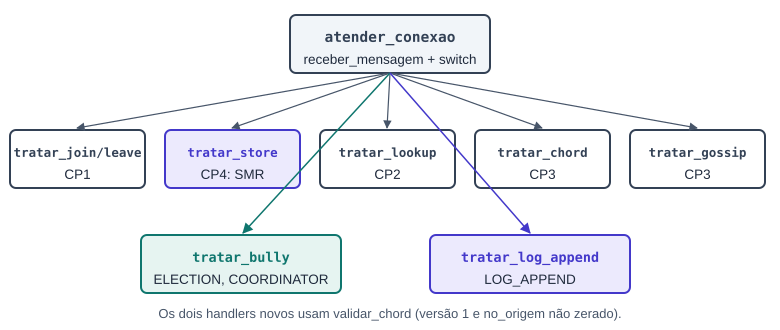

**Figura 7.** O `switch` ganhou dois handlers (`superpeer.c:660` e `superpeer.c:664`), e o `tratar_store` mudou.

Os handlers novos usam `validar_chord` (versão 1 e `no_origem` não zerado), a mesma validação das mensagens entre Super Peers do CP3.

## 1.6 Como as duas partes se encaixam

> **Bully (Aluno 1)**
>
> Responde "*quem é o coordenador?*" com `bully_get_coordinator`. Detecta a queda do coordenador pela membership do gossip e elege outro.

> **Log SMR (Aluno 2)**
>
> Responde "*em que ordem aplicar?*". Só o coordenador cria entradas; os followers só aceitam `LOG_APPEND` de quem o Bully diz ser o coordenador.

O caminho de um STORE junta as duas partes:

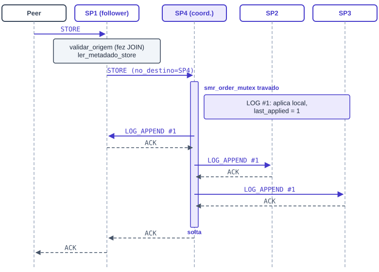

**Figura 8.** STORE feito no SP1 com o SP4 como coordenador. A barra azul é o tempo em que o `smr_order_mutex` fica travado.

1. O peer faz JOIN no SP1 e manda o STORE para ele. O SP1 valida como no CP2 (`validar_origem`: o peer precisa ter feito JOIN ali) e desserializa o metadado.
2. O SP1 não é o coordenador: repassa **a mesma mensagem** ao coordenador, trocando só o `no_destino` pelo NodeID do coordenador. O `no_origem` continua sendo o peer, que é o dono do arquivo.
3. O coordenador vê `no_destino` igual ao seu NodeID, entende que é um STORE repassado e pula a checagem de JOIN (o peer não fez JOIN nele). Chama `smr_put`, que cria `LOG #1`, aplica e manda `LOG_APPEND` a cada Super Peer vivo, um de cada vez.
4. A resposta do coordenador (ACK ou ERROR) volta ao SP1, que a devolve ao peer.

Pontos de contato no código:

- O **SMR usa o Bully** em dois lugares: `tratar_store` pergunta se este nó é o coordenador, e `smr_handle_log_append` só aceita `LOG_APPEND` cujo `no_origem` é o coordenador atual.
- O **Bully usa o SMR** em um lugar: ao assumir, imprime `resume operations (proximo LOG #n)` com `smr_last_applied() + 1`.
- Os dois usam a **membership do gossip** pelas consultas novas: o Bully para saber quem está vivo e se o coordenador caiu, o SMR para saber a quem mandar o `LOG_APPEND`.

## 1.7 O teste do Checkpoint 4 (`tests/c4/run.sh`)

O teste é o **script fornecido pelo professor**, usado sem alteração. Ele sobe os 4 Super Peers com `--config tests/config/c4.conf --port 510X`, todos escrevendo no mesmo `c4.log`, mata o SP4 aos 8 s e confere o log 19 s depois.

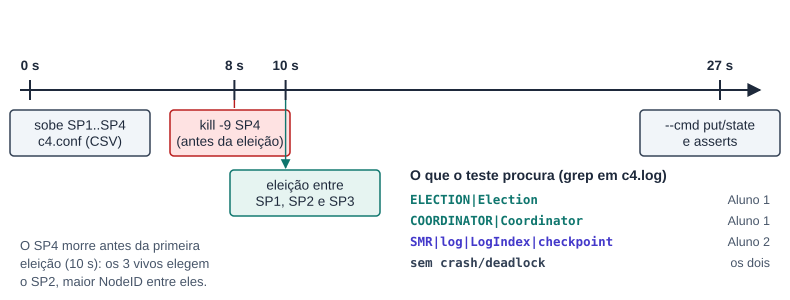

**Figura 9.** Linha do tempo do teste e qual aluno cobre cada checagem.

O SP4 morre **antes** da primeira eleição (o Bully espera 10 s). Aos 10 s os três vivos não têm coordenador, fazem a eleição, e o SP2 vence. Os comandos `--cmd put` e `--cmd state` do script não existem no `peer.c`, que manda um PING no lugar; o teste não depende da resposta deles.

Resultado na branch `checkpoint-4` (rodado para este documento): **PASS 4, FAIL 0**. Os testes anteriores continuam iguais: `tests/run.sh` (CP2) **PASS 4, FAIL 0** e `tests/c3/run.sh` (CP3) **PASS 5, FAIL 0**.

```text
==== C4 — Bully + SMR ====
[PASS] Eleição foi iniciada
[PASS] Novo coordenador foi anunciado
[PASS] Há evidência de SMR/log
[PASS] Sem crash/deadlock reportado em c4.log
PASS: 4
FAIL: 0
```

Trecho real do `c4.log` (os 4 processos escrevem misturados no mesmo arquivo):

```text
SMR: log de operacoes em memoria (ate 1024 entradas)
Bully: eleicao em 10 s, espera de COORDINATOR de 5 s
...
Chord: SP4 nao respondeu
start election
ELECTION -> SP4
ELECTION -> SP2
start election
ELECTION -> SP4
highest NodeID wins: SP2
COORDINATOR SP2
...
Coordenador: SP2 (este no)
resume operations (proximo LOG #1)
```

### Teste manual com upload

O script do professor não faz upload. Para mostrar o log replicado e a eleição **depois** de um coordenador já eleito, foi feito também um teste manual com os mesmos 4 Super Peers:

1. Sobe SP1 a SP4 e espera 15 s. O SP4 é eleito.
2. No SP1: `bin/client --cmd join` e `bin/client --cmd upload --file tests/data/documento_a.pdf`. O `LOG #1` aparece nos 4 logs.
3. `kill -9` no SP4 e espera 23 s (15 s de timeout do gossip + 5 s do Bully + 3 s).
4. No SP1: join e upload de `documento_b.pdf`. O `LOG #2` aparece nos 3 sobreviventes.
5. As linhas `LOG #`, `PUT` e `ObjectID` são idênticas nos 3 sobreviventes (mesmo `md5sum`), e nenhum log tem erro do AddressSanitizer.

---

# Parte 2. Aluno 2: Log de operações (SMR)

*Arquivo principal `smr.c` (380 linhas, novo) e `include/smr.h`. Também: `tratar_store` com repasse ao coordenador e `tratar_log_append` em `superpeer.c`, e o tipo `MSG_LOG_APPEND` em `protocol.h`.*

## 2.1 A ideia em uma página

A Seção 12 pede que todos os Super Peers tenham **o mesmo estado** do banco de metadados. Cada operação vira uma entrada num log, e todas as réplicas executam as entradas na mesma ordem. No CP4 a operação é o **PUT** (o STORE do CP2), e o log tem os campos da Seção 16.9: operation log, log index, transaction ID, version e checksum. O `smr.c` resolve isso assim:

1. **Só o coordenador cria entradas.** Um STORE que chega a outro Super Peer é repassado ao coordenador (`bully_get_coordinator`, Aluno 1).
2. **Sequência global.** A nova entrada recebe `LogIndex = last_applied + 1`. O coordenador aplica localmente (`metadata_table_insert` + `metadata_add_provider`, igual ao STORE do CP2) e só então manda `LOG_APPEND` a cada Super Peer vivo, **um de cada vez**.
3. **Ordem total.** O `smr_order_mutex` fica travado do começo ao fim do `smr_put`. Dois STORE ao mesmo tempo viram `LOG #n` e `LOG #n+1`, sem se misturar.
4. **Followers conferem antes de aplicar.** Só aceitam do coordenador atual, recalculam o checksum e só aplicam a entrada que é exatamente a próxima (`last_applied + 1`).

Depois de uma nova eleição, o novo coordenador continua do seu `last_applied + 1` ("resume operations"). Como ele já aplicou tudo o que o antigo replicou, a sequência não tem buraco.

### Decisões de projeto

| Decisão | Por quê |
|---|---|
| STORE **repassado** ao coordenador | O peer continua falando com o SP em que fez JOIN (nada muda no `peer.c`), e só um nó decide a ordem. |
| Repasse marcado por `no_destino` | O SP que repassa troca só o `no_destino` pelo NodeID do coordenador. O `no_origem` continua sendo o peer, o dono do arquivo. O coordenador pula a checagem de JOIN só nesse caso. |
| TransactionID de **128 bits** ([C-02]) | `segundos (48) | 64 bits mais significativos do NodeID (64) | sequência (16)`, big-endian. Resolve a contradição da nota [C-02] com o truncamento sugerido. |
| Timestamp = **relógio de Lamport** | A Seção 12.3 pede "tempo lógico". O coordenador incrementa a cada entrada; o follower faz `max(local, recebido) + 1`. |
| Checksum **SHA-256 do comando** | Seção 12.3. Cobre os campos da entrada, o metadado e o provedor. O follower recalcula e recusa se for diferente. |
| Log **em memória**, até 1024 entradas | É o que o CP4 pede: o log existe enquanto o processo roda. |
| Só **PUT** | É a operação que existe no sistema hoje (o STORE do CP2). |

## 2.2 Estruturas e constantes

```c
/* include/smr.h */
#define SMR_LOG_MAX 1024
#define SMR_OP_PUT 1
#define SMR_FIXED_LEN (8 + 16 + 1 + 32 + 8 + 8 + 32 + 4)   /* 109: parte fixa do LOG_APPEND */
typedef struct {
    uint64_t log_index;          /* sequência global, começa em 1 */
    uint8_t  transaction_id[16];
    uint8_t  operation;          /* SMR_OP_PUT = 1 */
    uint8_t  object_id[32];
    uint64_t timestamp;          /* relógio lógico de Lamport */
    uint64_t version;            /* versão do metadado após aplicar */
    uint8_t  checksum[32];       /* SHA-256 do comando */
} SmrLogEntry;

/* smr.c */
#define SMR_FIELDS_LEN (8 + 16 + 1 + 32 + 8 + 8)   /* 73: campos sem o checksum */
#define SMR_MEMBERS_MAX 64
static SmrLogEntry smr_log[SMR_LOG_MAX];
static int smr_count = 0;
static uint64_t smr_applied = 0;       /* last_applied */
static uint64_t smr_clock = 0;         /* Lamport */
static uint16_t smr_seq = 0;           /* sequência do TransactionID */
static uint8_t smr_self_id[NODE_ID_LEN];
static pthread_mutex_t smr_mutex = PTHREAD_MUTEX_INITIALIZER;
static pthread_mutex_t smr_order_mutex = PTHREAD_MUTEX_INITIALIZER;
```

`smr_mutex` protege o log, `last_applied`, o relógio e a sequência, e nunca fica travado durante rede. `smr_order_mutex` só é usado pelo `smr_put` no coordenador. `smr_self_id` é escrito em `smr_start`, antes de qualquer conexão ser atendida, e depois só é lido.

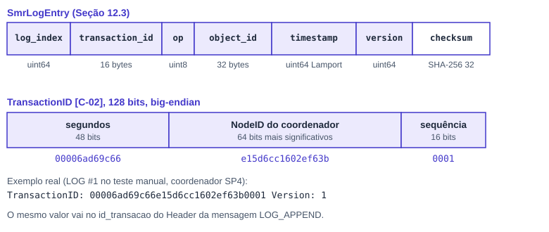

**Figura 10.** A entrada do log e o TransactionID, com o valor real do `LOG #1` do teste manual.

## 2.3 TransactionID, Lamport e checksum

- **TransactionID.** `smr_make_txid` grava os 6 bytes de baixo de `time(NULL)` (48 bits), os 8 primeiros bytes do NodeID do coordenador (os 64 bits mais significativos) e a sequência de 16 bits, tudo big-endian. No exemplo, `e15d6cc1602ef63b` é o começo do NodeID do SP4. Quando o SP2 assume, o `LOG #2` sai com `ac1d3cf0784676cc` no meio. O mesmo valor vai no `id_transacao` do Header da mensagem.
- **Lamport.** O coordenador faz `timestamp = ++smr_clock` a cada entrada. O follower, ao aplicar, faz `smr_clock = max(smr_clock, timestamp) + 1`. O `timestamp` do Header do LOG_APPEND também leva esse valor.
- **Checksum.** SHA-256 de um buffer com os 73 bytes dos campos (sem o próprio checksum), seguidos do metadado serializado e do NodeID do provedor. Assim, mudar o metadado ou o provedor no caminho também muda o checksum.

## 2.4 Execução

### No coordenador: `smr_put`

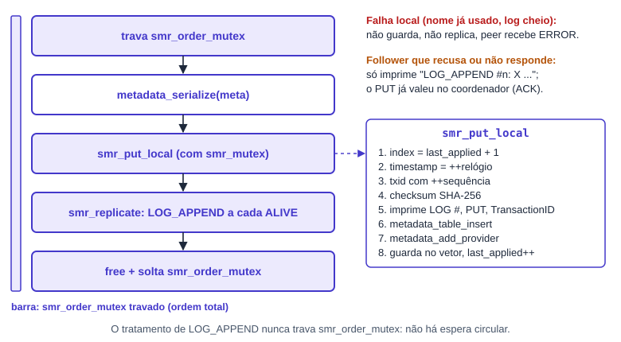

**Figura 11.** O `smr_put`. A barra da esquerda é o tempo em que o `smr_order_mutex` fica travado.

O PUT vale quando o coordenador aplica localmente: é isso que decide o ACK ao peer. Um follower que recusa ou não responde só gera uma linha de log; ele não desfaz o PUT.

### No follower: `smr_handle_log_append`

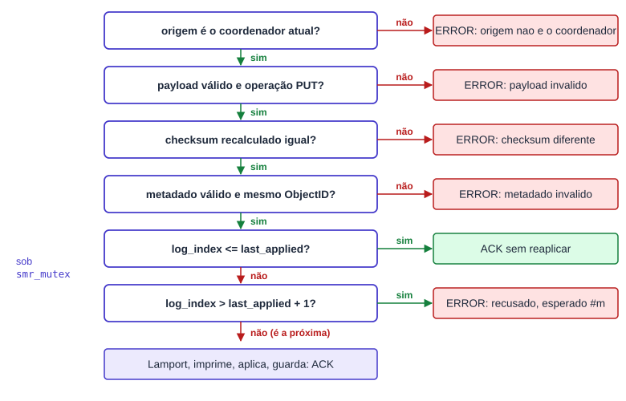

**Figura 12.** As conferências do follower, na ordem do código. As duas últimas são feitas com `smr_mutex` travado.

### Depois de uma nova eleição

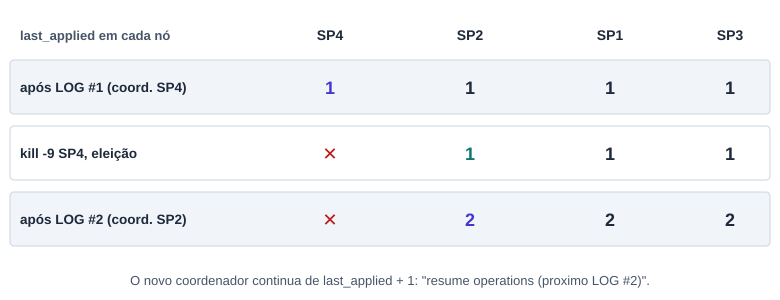

**Figura 13.** `last_applied` de cada nó no teste manual. O SP2 assume com `last_applied = 1`, e por isso o próximo PUT vira `LOG #2`.

## 2.5 Mensagem LOG_APPEND (26)

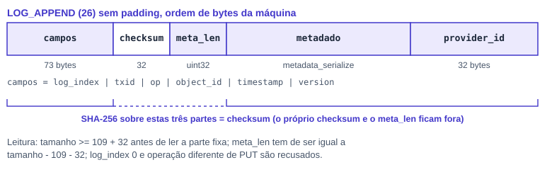

**Figura 14.** Payload do LOG_APPEND. Sem padding e na ordem de bytes da máquina, como no CP2.

```text
log_index (uint64) | transaction_id[16] | operation (uint8) | object_id[32] | timestamp (uint64)
| version (uint64) | checksum[32] | meta_len (uint32) | metadado (metadata_serialize) | provider_id[32]
```

- Resposta: `ACK` vazio (aplicou ou já tinha aplicado) ou `ERROR` (recusou).
- O metadado é o mesmo formato do STORE e do LOOKUP do CP2, com `owner` e `version` já preenchidos pelo coordenador.
- `provider_id` é o NodeID do peer que fez o upload, para o follower também registrar o provedor.

## 2.6 Função por função: `smr.c`

*Legenda das fichas: **Thread** = quem executa; **Mutex** = quais trava; **Rede** = mensagens trocadas; **Log** = o que imprime.*

### Início e consulta

#### `smr_start` · `smr.c:274`

**Thread:** main · **Mutex:** não · **Rede:** não · **Log:** SMR: log de operacoes em memoria (ate 1024 entradas)

Copia o NodeID do nó para `smr_self_id` e imprime a linha de partida. Devolve sempre 0.

#### `smr_last_applied` · `smr.c:282`

**Thread:** thread Bully · **Mutex:** smr_mutex · **Rede:** não · **Log:** não

Devolve `smr_applied` lido com o mutex. O Bully usa para imprimir `resume operations (proximo LOG #n)`.

### Coordenador

#### `smr_put` · `smr.c:295`

**Thread:** thread de conexão (STORE no coordenador) · **Mutex:** smr_order_mutex do começo ao fim · **Rede:** LOG_APPEND × N · **Log:** indireto

1. Recusa `meta` ou `provider` nulos. Trava `smr_order_mutex`.
2. `metadata_serialize` do metadado (o mesmo buffer serve para o checksum e para o payload).
3. `smr_put_local` cria e aplica a entrada. Se deu certo, `smr_replicate` manda aos followers.
4. Libera o buffer, solta o mutex e devolve 0 (aplicou) ou -1.

#### `smr_put_local` · `smr.c:182`

**Thread:** thread de conexão · **Mutex:** smr_mutex · **Rede:** não · **Log:** indireto (smr_apply_locked)

Com `smr_mutex` travado: preenche a entrada com `log_index = smr_applied + 1`, `timestamp = ++smr_clock`, TransactionID com `++smr_seq`, operação PUT, `object_id` e `version` do metadado. Calcula o checksum e chama `smr_apply_locked`. Criar e aplicar na mesma trava garante que ninguém mexe em `last_applied` no meio.

#### `smr_replicate` · `smr.c:246`

**Thread:** thread de conexão · **Mutex:** não (o gossip trava o dele) · **Rede:** LOG_APPEND → ACK/ERROR · **Log:** LOG_APPEND #n: X nao respondeu / X recusou

Monta o payload uma vez com `smr_write_payload`, copia os membros ALIVE com `gossip_alive_members` e manda a cada um com `smr_send`, um de cada vez. Falha de conexão ou resposta diferente de ACK só gera a linha de log. Libera o payload.

#### `smr_send` · `smr.c:207`

**Thread:** thread de conexão · **Mutex:** não · **Rede:** uma conexão por pedido · **Log:** não

Abre a conexão, monta o Header (versão 1, `MSG_LOG_APPEND`, `no_origem = smr_self_id`, `no_destino`, `id_transacao = TransactionID`, `timestamp = Lamport`), envia, recebe e fecha. Devolve o tipo da resposta.

### Follower

#### `smr_handle_log_append` · `smr.c:336`

**Thread:** thread de conexão · **Mutex:** smr_mutex (só no final) · **Rede:** não (a resposta é do `tratar_log_append`) · **Log:** LOG_APPEND recusado: ... / LOG_APPEND #n recusado: checksum diferente

Faz as conferências da Figura 12, nesta ordem:

1. `bully_get_coordinator` e compara com a `origem`. Diferente, ou sem coordenador: recusa.
2. `smr_read_payload` e operação igual a PUT.
3. Recalcula o checksum com `smr_checksum` e compara com `memcmp`.
4. `metadata_deserialize` do metadado e confere que o `object_id` dele é o da entrada.
5. Trava `smr_mutex`, chama `smr_append_locked`, solta e libera o metadado em todos os caminhos.

#### `smr_append_locked` · `smr.c:320`

**Thread:** thread de conexão · **Mutex:** já travado · **Rede:** não · **Log:** LOG #n recusado: esperado #m

- `log_index <= last_applied`: já aplicada, devolve 0 (ACK) sem reaplicar.
- `log_index > last_applied + 1`: falta uma entrada antes. Imprime `LOG #n recusado: esperado #m` e devolve -1.
- Igual a `last_applied + 1`: atualiza o Lamport e chama `smr_apply_locked`.

### Comum aos dois lados

#### `smr_apply_locked` · `smr.c:163`

**Thread:** thread de conexão · **Mutex:** já travado (smr_mutex) · **Rede:** não · **Log:** LOG #n / PUT nome / TransactionID ... Version ... Checksum ...

1. Log cheio (1024): imprime `SMR: log cheio` e devolve -1.
2. `smr_print`: imprime as três linhas da entrada.
3. `metadata_table_insert`, que imprime o metadado logo depois (`File`, `Size`, `ObjectID`, chunks). Se falhar (nome já usado por outro ObjectID, tabela cheia): `SMR: falha ao aplicar LOG #n` e devolve -1.
4. `metadata_add_provider` com o provedor da entrada.
5. Guarda a entrada no vetor e avança `smr_applied`.

> O coordenador e os followers usam esta mesma função. Por isso a saída é igual em todos os nós, e o teste manual compara as linhas `LOG #`, `PUT` e `ObjectID` com `md5sum`.

#### `smr_checksum` · `smr.c:92`

**Thread:** thread de conexão · **Mutex:** não · **Rede:** não · **Log:** não

Aloca `73 + meta_len + 32` bytes, escreve os campos com `smr_write_fields`, copia o metadado e o provedor, calcula `SHA256()` (OpenSSL) e libera. Devolve -1 se o `malloc` falhar.

#### `smr_write_fields` · `smr.c:75`

**Thread:** quem chamar · **Mutex:** não · **Rede:** não · **Log:** não

Escreve os 73 bytes `log_index | transaction_id | operation | object_id | timestamp | version` com `memcpy`. É usada pelo checksum e pelo payload, então os dois sempre concordam.

#### `smr_write_payload` · `smr.c:110`

**Thread:** thread de conexão · **Mutex:** não · **Rede:** não · **Log:** não

Aloca `109 + meta_len + 32` bytes e escreve campos, checksum, `meta_len`, metadado e provedor. Quem chamou faz o `free`.

#### `smr_read_payload` · `smr.c:129`

**Thread:** thread de conexão · **Mutex:** não · **Rede:** não · **Log:** não

Exige `tamanho >= 109 + 32` **antes** de ler qualquer campo fixo. Lê os campos e o `meta_len`, e recusa `log_index == 0` ou `meta_len != tamanho - 109 - 32`. O metadado não é copiado: `*meta_buf` aponta para dentro do payload, que continua válido enquanto a mensagem existir.

#### `smr_make_txid` · `smr.c:61`

**Thread:** thread de conexão · **Mutex:** chamada com smr_mutex · **Rede:** não · **Log:** não

Monta o TransactionID da Seção 2.3.

#### `smr_print` e `smr_print_hex` · `smr.c:49` e `smr.c:39`

**Thread:** thread de conexão · **Mutex:** não · **Rede:** não · **Log:** as três linhas do LOG

Imprimem `LOG #n`, `PUT <filename>` e `TransactionID: <hex>  Version: <v>  Checksum: <hex>`, no formato do exemplo da Seção 16.9.

## 2.7 Código do Aluno 2 fora do `smr.c`

### superpeer.c

#### `tratar_store` · `superpeer.c:377`

**Thread:** thread de conexão · **Mutex:** não · **Rede:** responde ao peer; pode repassar · **Log:** STORE: sem coordenador / STORE recusado: ...

1. `repassado = (no_destino == NodeID deste nó)`. Se é repassado, valida com `validar_chord`; senão, com `validar_origem` (exige JOIN, como no CP2).
2. `ler_metadado_store`: desserializa, confere os chunks e marca dono e versão.
3. Decide quem trata:
   - sem coordenador: `STORE: sem coordenador`, `ERROR`;
   - este nó é o coordenador: `smr_put(&meta, no_origem)`; 0 vira `ACK`, -1 vira `ERROR`;
   - não é o coordenador e o STORE já veio repassado: `ERROR` (evita repasse em laço);
   - não é o coordenador: `repassar_store` e devolve o tipo que o coordenador respondeu.
4. Libera o metadado e responde ao peer.

#### `ler_metadado_store` · `superpeer.c:326`

**Thread:** thread de conexão · **Mutex:** não · **Rede:** não · **Log:** STORE recusado: metadado invalido / chunk_count nao bate

Separada do `tratar_store` para deixar a função curta. `metadata_deserialize`, `metadata_check_chunks` (libera o metadado se falhar) e `owner = no_origem`, `version = 1`, exatamente como no CP2.

#### `repassar_store` · `superpeer.c:345`

**Thread:** thread de conexão · **Mutex:** não · **Rede:** STORE → coordenador · **Log:** STORE repassado ao coordenador X: ACK / STORE: sem coordenador

Copia o Header e o ponteiro do payload (a mensagem original não é alterada), troca o `no_destino` pelo NodeID do coordenador, abre a conexão, envia, recebe e fecha. Se a conexão ou a resposta falhar, imprime `STORE: sem coordenador` e devolve `MSG_ERROR`. Senão, devolve o tipo da resposta do coordenador.

#### `tratar_log_append` · `superpeer.c:609`

**Thread:** thread de conexão · **Mutex:** não · **Rede:** responde ACK ou ERROR · **Log:** indireto

`validar_chord` e `smr_handle_log_append(no_origem, payload, tamanho)`. 0 vira `ACK`; qualquer falha vira `ERROR`.

No `atender_conexao` entrou o caso `MSG_LOG_APPEND`, e no `main` a chamada `smr_start(&superpeer)`.

### protocol.h e protocol.c

`MSG_LOG_APPEND = 26` depois de `MSG_TOPOLOGY = 25`, e os nomes `ELECTION`, `OK`, `COORDINATOR` e `LOG_APPEND` em `nome_do_tipo`.

## 2.8 O que mudou em relação ao CP3

Base de comparação: branch `unificacao-checkpoint-3`, commit `6939811`. O CP4 foi feito direto na branch `checkpoint-4`, criada a partir dela.

| Arquivo |  | Mudança |
|---|---|---|
| `smr.c` | **[novo]** | Arquivo inteiro: log, TransactionID, Lamport, checksum, coordenador e follower. |
| `include/smr.h` | **[novo]** | Constantes, `SmrLogEntry` e as quatro funções públicas. |
| `superpeer.c` | **[alterado]** | `tratar_store` dividido em `ler_metadado_store`, `repassar_store` e a decisão coordenador/repasse; `tratar_log_append`; caso 26 no despacho; `smr_start` no `main`. |
| `include/protocol.h` | **[alterado]** | `MSG_LOG_APPEND = 26`. |
| `protocol.c` | **[alterado]** | Quatro nomes novos em `nome_do_tipo`. |
| `Makefile` | **[alterado]** | `build/smr.o` no superpeer e a regra de dependências dele. |
| `metadata.c` | **[igual]** | O SMR usa `metadata_serialize`, `metadata_deserialize`, `metadata_table_insert` e `metadata_add_provider` sem mudança. |

```diff
@@ superpeer.c: tratar_store (CP3 → CP4) @@
-    resultado = metadata_table_insert(&meta);
-    if (resultado == METADATA_OK) {
-        metadata_add_provider(meta.object_id, msg->header.no_origem);
-    }
+    if (!bully_get_coordinator(&coord)) {
+        printf("STORE: sem coordenador\n");
+        tipo = MSG_ERROR;
+    } else if (node_id_compare(coord.id, self) == 0) {
+        tipo = (smr_put(&meta, msg->header.no_origem) == 0) ? MSG_ACK : MSG_ERROR;
+    } else if (repassado) {
+        tipo = MSG_ERROR;
+    } else {
+        tipo = repassar_store(msg, &coord);
+    }
@@ include/protocol.h @@
-    MSG_TOPOLOGY = 25
+    MSG_TOPOLOGY = 25,
+    MSG_LOG_APPEND = 26
```

## 2.9 Observações sobre o comportamento atual

> **Pontos que vale conhecer (não quebram o teste)**
>
> - **Follower que perde uma entrada fica para trás.** Se um follower não recebe o `LOG #n`, ele recusa todos os seguintes com `LOG #m recusado: esperado #n`. Buscar as entradas que faltam não faz parte deste checkpoint.
> - **Log só em memória.** Um Super Peer reiniciado volta com `last_applied = 0` e recusa as entradas novas pelo mesmo motivo.
> - **PUT repetido gera entrada nova.** Um upload do mesmo arquivo (mesmo ObjectID) cria outro `LOG #n`. O `metadata_table_insert` imprime `STORE: ObjectID ja registrado, tabela inalterada` e a versão continua 1.
> - **Replicação sequencial e sem timeout.** Os LOG_APPEND vão um de cada vez com `smr_order_mutex` travado. Um follower lento atrasa todos os STORE, e um follower que aceita a conexão e não responde travaria o coordenador. Com `kill -9` em localhost a conexão é recusada na hora.
> - **Sequência por processo.** O contador de 16 bits do TransactionID começa em 0 em cada processo. A unicidade vem da combinação com os segundos e com o NodeID.
> - **Nome com caminho.** O `PUT` mostra o nome que o peer mandou no metadado (`tests/data/documento_a.pdf`), como no CP2.

## 2.10 Log real da parte do Aluno 2

No SP1 (follower), com o upload feito nele:

```text
RX STORE de 64ab6706...
LOG #1
PUT tests/data/documento_a.pdf
TransactionID: 00006ad69c66e15d6cc1602ef63b0001  Version: 1  Checksum: 8e04b18e7f036071e097fcc4f1982a2afcf795558a809aae17e0a319e3ef2fdc
STORE repassado ao coordenador SP4: ACK
```

No SP4 (coordenador), para o mesmo STORE:

```text
RX STORE de 64ab6706...
LOG #1
PUT tests/data/documento_a.pdf
TransactionID: 00006ad69c66e15d6cc1602ef63b0001  Version: 1  Checksum: 8e04b18e7f036071e097fcc4f1982a2afcf795558a809aae17e0a319e3ef2fdc
File: tests/data/documento_a.pdf
...
ObjectID:
...
```

Depois da queda do SP4, no SP3 (follower do novo coordenador SP2):

```text
LOG #2
PUT tests/data/documento_b.pdf
TransactionID: 00006ad69c7eac1d3cf0784676cc0001  Version: 1  Checksum: 7040ce269092fea4b98b09723c9d9499da463c195ea52bc09c1257782c757291
```

*No SP1 o `LOG #1` aparece antes do `STORE repassado` porque o coordenador manda o LOG_APPEND ao SP1 antes de responder ao repasse. O `0001` do fim do TransactionID do `LOG #2` mostra que a sequência é do SP2, que começa a contar quando assume.*
